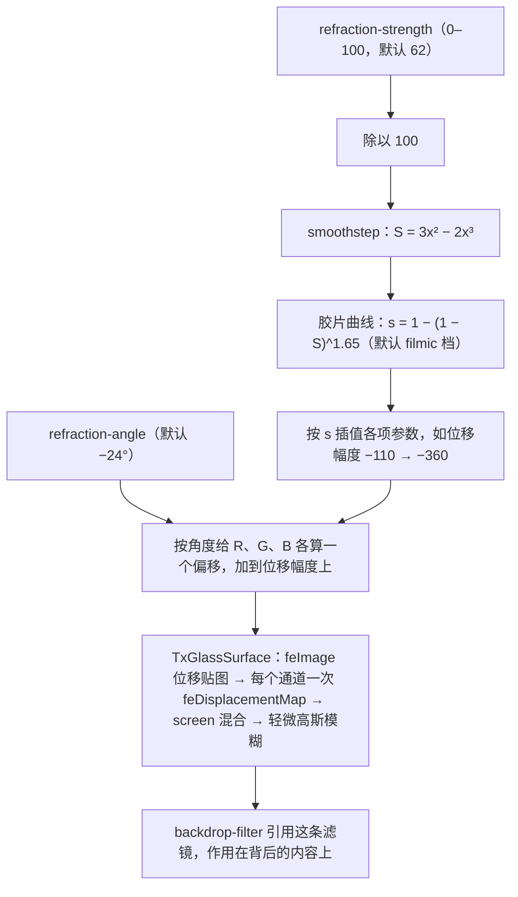
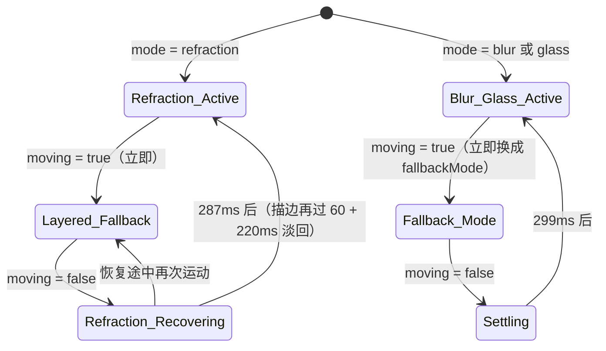

# 第二篇：材质系统、折射着色器与运动降级 (Surfaces & Material Physics)

> 涵盖章节：第 5 章 ～ 第 11 章  
> 核心主题：五种 Surface 材质与默认的 `refraction`；琉光折射（Refraction）管线；运动降级与分层恢复；噪点掩膜与折射光源跟随。

---

## 第 5 章：Surface 材质哲学与选型矩阵

### 5.1 为什么现代专业工具需要物理材质？

扁平化设计（Flat Design）过度剔除了物理暗示，导致界面元素缺乏空间层级感知；而早期拟物化（Skeuomorphism）则充斥着沉重的仿皮纹与浮雕，干扰阅读焦点。

TuffEx 提出的**“次表面材质学”（Sub-surface Materiality）**，借鉴了光学材料物理特性。通过控制光线的透射、折射与微表面散射，在屏幕上建立清晰、轻盈但坚实的空间秩序。

`TxBaseSurface` 的 `mode` 一共五种（`BaseSurfaceMode`），每种由几层叠成：玻璃层（`TxGlassSurface`）用于 `glass` 与 `refraction`，背景滤镜层用于 `blur` 与 `refraction`，色膜层用于 `mask`，折射描边只在 `refraction` 上。

| 材质模式 | 渲染管线（默认参数） | 物理隐喻 | 默认用在 |
|---|---|---|---|
| `refraction` | 玻璃层之上叠背景模糊与饱和度滤镜层，外加 1px 折射描边 | 冰晶 / 棱镜 | 所有带材质层的组件：TxBaseSurface、TxCard、TxFlipOverlay，以及浮层面板 TxPopover、TxTooltip、TxDropdownMenu 与 TxContextMenu（及各自的子菜单）、TxSelect、TxSearchSelect |
| `glass` | 玻璃层：SVG 位移贴图让 R、G、B 三个通道各自错开，再 `saturate(1.8)`；Safari、Firefox 退回 `backdrop-filter` 背景模糊 | 棱镜玻璃 | 没有组件默认使用 |
| `blur` | `backdrop-filter: blur(10px) saturate(1.5)`，叠一层 10% 的浮层底色 | 雾化毛玻璃 | 没有组件默认使用 |
| `mask` | 半透明色膜（不透明度 0.75），不做模糊 | 墨色薄膜 | 没有组件默认使用；`blur`、`glass` 运动时默认降级到它 |
| `pure` | 不透明实色（`--tx-fill-color-lighter`），背景完全不透出 | 坚硬底板 | 没有组件默认使用 |

### 5.2 默认材质一律为 `refraction` 的严肃铁律

在 TuffEx 体系中，**带材质层的容器默认材质一律为 `refraction`（琉光/折射）**。组件的默认值都照这条规则取：`TxBaseSurface` 的 `mode`、`TxCard` 的 `background`、`TxFlipOverlay` 的 `surface`，以及上表那些弹出面板的 `panelBackground`（它们都经 `TxBaseAnchor` 渲染）。`TxModal`、`TxDrawer` 等弹窗与抽屉不经过 `TxBaseSurface`，没有材质可选。

> **硬性门禁准则**：若因特殊场景需要把材质（`mode`、`background`、`surface`、`panelBackground`）从 `refraction` 换成别的（如 `pure` / `mask` / `blur` / `glass`），**必须经过用户手动明确确认**，不得由 AI 或开发人员擅自替换默认材质。
> 这一铁律确保了全局视觉的一致性，防止多个开发者或 Agent 各自为政造成界面碎片化。

---

## 第 6 章：折射材质（Refraction）渲染管线与色散模型

### 6.1 斯涅尔定律与色散物理模拟

当光线从空气进入高折射率介质时，根据斯涅尔定律（Snell's Law）：
$$n_1 \sin\theta_1 = n_2 \sin\theta_2$$
光线方向发生偏折。由于不同波长的光折射率不同（色散现象，Dispersion）：
$$n_{\text{Blue}} > n_{\text{Green}} > n_{\text{Red}}$$
白光折射后在边缘处会分解出红蓝偏移的微弱光谱色相（Chromatic Aberration）。`TxBaseSurface` 的 `refraction` 模式以 `TxGlassSurface` 为玻璃层：一条 SVG 位移贴图滤镜让 Red、Green、Blue 三个通道各自位移一次，三次的位移幅度略有不同（默认 scale 依次为 −180、−170、−160），通道错开后在折射边缘分离出微弱的光谱彩边，在纯 Web 技术栈中还原光学质感。



只有传了 `refraction-strength`、`refraction-angle`、`refraction-profile` 三者之一，组件才走上面这套强度模型；否则用固定的默认参数（位移幅度 −180，三个通道依次 −180、−170、−160）。

### 6.2 强度平滑模型：Smoothstep 曲线

为了避免折射强度在低数值时突变、高数值时失真，`TxBaseSurface` 收到 `refraction-strength` 后先除以 100，再过计算机图形学经典的 `smoothstep` 曲线，之后按 `refraction-profile` 再过一条胶片曲线：

```ts
// packages/tuffex/packages/components/src/base-surface/src/base-surface-math.ts
export function smoothstep01(value: number) {
  const t = clamp(value, 0, 1)
  return t * t * (3 - 2 * t)
}

// packages/tuffex/packages/components/src/base-surface/src/TxBaseSurface.vue
const filmicRefractionStrength = computed(() => {
  const eased = smoothstep01(normalizedRefractionStrength.value)
  if (resolvedRefractionProfile.value === 'soft') {
    return 1 - (1 - eased) ** 1.15
  }
  if (resolvedRefractionProfile.value === 'cinematic') {
    return 1 - (1 - eased) ** 2.2
  }
  return 1 - (1 - eased) ** 1.65
})
```

`smoothstep` 两端斜率为 0，强度在起点和终点附近变化很慢，不会一推就跳。各项参数最后按胶片曲线的结果在两端之间插值，例如默认 `filmic` 档的位移幅度从 −110 走到 −360，所以强度为 0 时仍保留 −110 的位移。

### 6.3 位移贴图与浏览器回退

玻璃层的位移贴图不是 `feTurbulence` 噪声，而是 `feImage` 引用的一张按元素尺寸生成的 SVG：红色水平渐变、蓝色垂直渐变，中间一块模糊的灰色。灰色里各点位移相同，只是整体平移，弯折集中在边缘一圈；元素尺寸变化时 `ResizeObserver` 会重新生成这张贴图。滤镜以 `backdrop-filter: url(#…)` 作用在背后的内容上，Safari 与 Firefox 不走这条滤镜，退回 `backdrop-filter` 背景模糊。

---

## 第 7 章：材质的运动信号：`moving` 与 `autoDetect` (Surface Motion Signals)

### 7.1 为什么运动时要降级？

折射与背景模糊都靠 `backdrop-filter` 采样身后的内容。材质随元素一起移动时，取样会落后于元素的位置，滤镜层拖着一块错位的背景走。`TxBaseSurface` 因此在运动期间降级，停下后再恢复（见第 8 章）。

### 7.2 两个入口

`TxBaseSurface` 不测指针速度，也不监听窗口拖动、电量或帧耗时。它只认两个入口：
1. **`moving` 属性**：由宿主组件在自己运动时置为 `true`。TuffEx 里，`TxBaseAnchor` 的弹出面板在部分打开、关闭动画期间设置它（`surfaceMotionAdaptation` 默认 `auto`），`TxFlipOverlay` 在翻转动画期间设置它，`TxCard` 在惯性跟随（`inertial`）运动期间设置它。
2. **`autoDetect`**（默认关闭）：打开后，组件在材质元素及其所有祖先元素上监听 `transform` / `translate` 的 `transitionstart`、`transitionend`、`transitioncancel`，并用 `MutationObserver` 观察这些元素的内联 `style`：任一元素带内联 `transform` 即视为运动，全部去掉后视为停止。

```vue
<!-- 宿主自己知道何时在动：直接传 moving -->
<TxBaseSurface :moving="dragging" />

<!-- 由自身或祖先元素的 transform 过渡、内联 transform 推断 -->
<TxBaseSurface mode="blur" auto-detect />
```

宿主如果按指针速度驱动 `moving`（例如速度超过 $1.2\text{px/ms}$ 立即置为 `true`，低于阈值满 140ms 才清除），防抖也要宿主自己做。

---

## 第 8 章：运动降级与分层恢复

### 8.1 blur 与 glass：整体换材质

- **降级**：`moving` 一置为 `true`，渲染模式立即换成 `fallbackMode`。默认是 `mask`，色膜不透明度取 `fallbackMaskOpacity`（`TxBaseSurface` 默认 0.95，`TxCard` 传 0.26）；也可以设为 `pure`。
- **恢复**：运动结束后先保持降级 `max(transitionDuration, settleDelay)`，默认 `max(299, 150)` = 299ms，再换回原材质。

### 8.2 refraction：分层降级、分层恢复

`refraction` 不换材质，而是分层降级：
- **降级**：玻璃层和滤镜层在 140ms 内淡出，一层半透明遮盖在 180ms 内升到 0.55，折射参数的混合进度降到 0.28，折射描边立即隐藏。
- **恢复**：运动一结束就开始，没有等待期。参数在 182ms 内回满；遮盖先停 60ms，再用 227ms 撤完，到 287ms 结束；玻璃层和滤镜层延迟 80ms 后用 220ms 淡回；恢复结束后再过 60ms，描边用 220ms 淡回。恢复途中再次运动，会直接回到降级状态。

`pure` 与 `mask` 没有滤镜层，运动时不做任何处理。

### 8.3 状态机



---

## 第 9 章：亚克力、云母与折射玻璃的平台边界

### 9.1 平台体系横向对比

| 体系 | 代表材质 | 光学原理 | 核心优势 | 缺陷与局限 |
|---|---|---|---|---|
| **Apple** | Liquid Glass（2025 年随 macOS Tahoe 26 等推出）与标准材质（AppKit 的 `NSVisualEffectView`） | 标准材质模糊并透出背后的内容，再加 vibrancy：把前景与背景的颜色混合以拉开对比，灰度前景效果最好。Liquid Glass 是控件与导航层的半透明材质，反射、折射周围的内容；常用的 regular 变体模糊背景并调整亮度，保证文字可读 | 系统统一绘制，AppKit 控件自动加 vibrancy；跟随「减少透明度」「增强对比度」等系统设置 | 只在 Apple 平台。网页拿不到，Electron 只能给整个窗口设 `vibrancy`：Tuff 的窗口在 macOS 上就用 `fullscreen-ui` 垫底 |
| **Microsoft Fluent** | Mica（云母）/ Acrylic（亚克力） | Mica 不透明，按主题给桌面壁纸染色，铺在长驻窗口的背景上；Acrylic 由背景、模糊、排除混合、染色、噪点五层叠成 | Mica 只采样一次壁纸，开销很小；窗口失焦时退回中性色，帮用户分辨哪个窗口在前 | Acrylic 吃 GPU、耗电，不建议铺在应用的大面积背景上；关掉「透明效果」或进入节电模式时，两者都退回纯色。Tuff 的窗口在 Windows 上用 Mica 垫底 |
| **Google Material 3** | Surface Container 色阶 | 不透明的纯色，按层级取同一色系里明度不同的色调。早期按高度叠加半透明的主色（surface tint），现已换成不随高度变化的色调角色 | 没有模糊和透明，几乎没有渲染开销，各平台一致 | 透不出背后的内容，层次只靠色调与阴影区分 |
| **Tuff / TuffEx** | **Refraction (琉光)** | **SVG 位移贴图分通道位移（色散光谱偏移）+ 背景模糊与饱和度滤镜层 + 1px 折射描边** | **纯 Web 技术栈（SVG 滤镜 + `backdrop-filter`）实现，桌面端与 Nexus 共用一套** | **SVG 位移滤镜只在 Chromium 内核生效，Safari、Firefox 退回背景模糊；材质移动时必须降级** |

---

## 第 10 章：噪点掩膜与微质感物理着色

### 10.1 为什么传统混合模式（Overlay / Soft-light）会发灰？

许多设计教程推荐给磨砂玻璃添加 5% 的白色或黑色噪点，并使用 CSS `mix-blend-mode: overlay`。
在浅色或极低透明度的底色上，这种做法是灾难性的：
$$\text{Overlay}(A, B) = \begin{cases} 2AB & B < 0.5 \\ 1 - 2(1-A)(1-B) & B \ge 0.5 \end{cases}$$
在 16% 左右的极淡色洗（Wash）上，噪点会让原本清透的色彩像素瞬间蒙上一层**脏灰色的噪斑**，在 Retina 2x 高清屏上尤为刺眼。

### 10.2 TuffEx 解决方案：`mask-composite: intersect` Alpha 噪点

TuffEx 不去改变像素颜色，而是**将噪点直接编织进透明度通道（Alpha Channel）**：

```scss
// 正确：通过掩膜交集将噪点注入到透明通道，背景色彩永不发灰
@supports (mask-composite: intersect) {
  .tx-status-hint__wash {
    background-color: var(--tx-status-hint-accent, #67c23a);
    // 线性渐变与分形噪点进行交集合成
    mask-image:
      linear-gradient(
        to right,
        rgb(0 0 0 / var(--tx-status-hint-wash-strength, 0.26)),
        rgb(0 0 0 / calc(var(--tx-status-hint-wash-strength, 0.26) * 0.45)) 38%,
        transparent
      ),
      $grain; // 140px 见方的 feTurbulence 分形噪点 SVG
    mask-size: 100% 100%, 140px 140px;
    mask-repeat: no-repeat, repeat;
    mask-composite: intersect;
  }
}
```

这样，噪点只决定“当前色彩透出多少”，底层背景的干净程度完全不受污染。噪点的 alpha 平均约 0.6，所以前缘 0.26 的强度在浅色主题里约合 16%；暗色主题取 0.2，因为同样的色调在深色页面上更显眼。

---

## 第 11 章：物理光源追踪与动态光斑

### 11.1 折射光源跟随（Specular Follow）

`TxCard` 的光源跟随默认关闭，只在 `background` 为 `refraction`（默认值）且打开 `refraction-light-follow-mouse` 时工作：

```vue
<TxCard refraction-light-follow-mouse>
  <!-- 卡片内容 -->
</TxCard>
```

- **相对坐标采样**：指针在卡片上移动时，组件把光标位置换算成卡片内 0–1 的归一化坐标，作为光源的目标点；指针离开卡片，目标点回到中心 (0.5, 0.5)。
- **移动折射的光源点**：光源点经 `TxBaseSurface` 的 `refraction-light-x/y` 写成 `--tx-surface-refraction-light-x/y`，决定折射滤镜层与色膜层上几处径向光晕的位置，其中一处落在对角的对称点上。组件不另加白色高光层。
- **随指针微调强度与角度**：光源离中心越远，折射强度最多加 16 × `refraction-light-follow-intensity`（默认 0.45，即最多 +7.2）；折射角度按同一系数向指针方向插值。

### 11.2 弹簧平滑

为了防止鼠标快速移动时光斑机械跳动，光源点不直接跳到目标点，而是由一根逐帧积分的弹簧带过去：
$$v \leftarrow \left(v + k\,(P_{\text{target}} - P)\,\Delta\right) c^{\Delta}, \qquad P \leftarrow \operatorname{clamp}(P + v\,\Delta,\ 0,\ 1)$$
k 是 `refraction-light-spring-stiffness`（默认 0.15，取值限制在 0.01–0.55），c 是 `refraction-light-spring-damping`（默认 0.6，限制在 0.55–0.99），Δ 是帧间隔除以 16.67ms（限制在 0.1–2，第一帧取 1）。位置差与速度都小于 0.002 时视为停稳，循环随之停止。关掉 `refraction-light-spring`，光源点直接跳到目标点。按 60Hz 推算，默认参数下一次跳变只冲过目标约 3%，约 130ms 后稳定在 5% 以内。位置这一步也乘 Δ，所以 120Hz、144Hz 屏幕上光源点的走法与 60Hz 基本一致。
