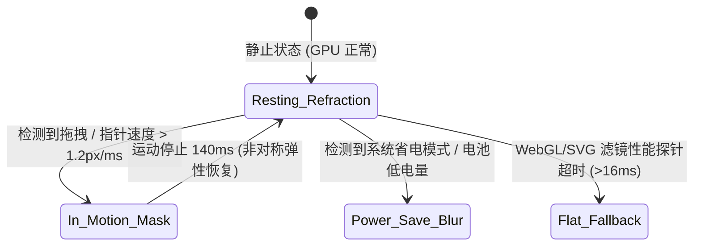

# 第二篇：材质系统、折射着色器与环境自动感知 (Surfaces & Material Physics)

> 涵盖章节：第 5 章 ～ 第 11 章  
> 核心主题：琉光折射（Refraction）物理模型；自动环境感知与动态推断；运动自适应降级；噪点掩膜与光斑追踪。

---

## 第 5 章：Surface 材质哲学与选型矩阵

### 5.1 为什么现代专业工具需要物理材质？

扁平化设计（Flat Design）过度剔除了物理暗示，导致界面元素缺乏空间层级感知；而早期拟物化（Skeuomorphism）则充斥着沉重的仿皮纹与浮雕，干扰阅读焦点。

TuffEx 提出的**“次表面材质学”（Sub-surface Materiality）**，借鉴了光学材料物理特性。通过控制光线的透射、折射与微表面散射，在屏幕上建立清晰、轻盈但坚实的空间秩序：

| 材质模式 | 渲染核心技术 | 物理隐喻 | 适用场景 | 性能开销 |
|---|---|---|---|---|
| `refraction`（默认） | SVG Displacement Map + RGB 色散通道位移 | 冰晶 / 高纯度棱镜 | CoreBox、主操作卡片、弹窗容器、抽屉 | 中～高（带自适应降级） |
| `glass` | Backdrop Filter Blur + 高光边缘环 | 物理磨砂钢化玻璃 | 悬浮浮条、临时弹出面板 | 中 |
| `acrylic` | 亚克力多级模糊 + 噪点漫反射 | 漫反射有机玻璃 | 系统侧边栏、状态抽屉（类似 Windows Acrylic） | 中 |
| `mica` | 双调和表面采样 + 低饱和基底 | 动态云母薄片 | 窗口主底板（类似 Windows 11 Mica） | 极低（单层计算） |
| `mask` | 半透明纯色 Alpha 遮罩 | 纯净墨色薄膜 | 快速移动中的降级态、紧凑数据列表行 | 极低 |
| `blur` | 纯原生 CSS `backdrop-filter: blur(20px)` | 简化雾化玻璃 | 低端 GPU 兼容回退 | 低 |
| `flat` | 纯色实底面板 | 实心硬质塑料 | 无透明度需求的表格底层、高对比度模式 | 零 |
| `plain` | 无样式容器透明穿透 | 空无一物 | 逻辑分组占位符 | 零 |

### 5.2 默认材质一律为 `refraction` 的严肃铁律

在 TuffEx 体系中，**所有承载核心交互的表面容器，默认材质必须统一为 `refraction`（琉光/折射）**。

> **硬性门禁准则**：若因特殊场景需要将 surface 切换为其他材质（如 flat / plain / mask / glass），**必须经过用户手动明确确认**，不得由 AI 或开发人员擅自替换默认材质。
> 这一铁律确保了全局视觉的一致性，防止多个开发者或 Agent 各自为政造成界面碎片化。

---

## 第 6 章：折射材质（Refraction）渲染管线与色散模型

### 6.1 斯涅尔定律与色散物理模拟

当光线从空气进入高折射率介质时，根据斯涅尔定律（Snell's Law）：
$$n_1 \sin\theta_1 = n_2 \sin\theta_2$$
光线方向发生偏折。由于不同波长的光折射率不同（色散现象，Dispersion）：
$$n_{\text{Blue}} > n_{\text{Green}} > n_{\text{Red}}$$
白光折射后在边缘处会分解出红蓝偏移的微弱光谱色相（Chromatic Aberration）。TuffEx 的 `TxGlassSurface` 与 `TxBaseSurface` 正是通过在 SVG 频域位移滤镜中分置 RGB 通道偏移向量，在纯 Web 技术栈中还原了真实光学质感。

```mermaid
flowchart TD
    In[业务参数: strength, angle, tone] --> Calc[TxBaseSurface 归一化计算模型]
    Calc --> Smooth[Smoothstep 曲线矫正: S(x) = 3x² - 2x³]
    Smooth --> Dispersion[RGB 三通道角偏移矩阵生成]
    Dispersion --> SVGFilter[TxGlassSurface: feTurbulence + feDisplacementMap]
    Dispersion --> CSSVars[写入 CSS 变量: --tx-refract-x, --tx-refract-y]
    SVGFilter --> Compositor[GPU 渲染管线合成最终折射视效]
    CSSVars --> Compositor
```

### 6.2 强度平滑模型：Smoothstep 曲线

为了避免折射强度在低数值时突变、高数值时失真，TuffEx 引入计算机图形学经典的 `smoothstep` 曲线进行参数归一化映射：

```ts
// packages/tuffex/packages/components/src/base-surface/src/utils.ts
export function smoothstep(min: number, max: number, value: number): number {
  const x = Math.max(0, Math.min(1, (value - min) / (max - min)));
  return x * x * (3 - 2 * x); // S(x) = 3x² - 2x³
}
```

---

## 第 7 章：材质的动态推断与环境感知系统 (Automatic Surface Deduction)

### 7.1 为什么不能依靠人工切换材质？

在桌面客户端中，运行时环境是高度波动的：
1. 用户可能正以 120Hz 高刷新率拖拽窗口。
2. 笔记本可能拔掉电源进入电池节能模式（Battery Saver）。
3. 机器可能在老旧核显上运行。
如果依靠业务代码手动判断并降级材质，必然导致代码充斥大量环境分支判断。TuffEx 设计了**环境感知自动推断引擎（`autoDetect`）**。

### 7.2 感知信号矩阵与推断逻辑



1. **指针速度感知**：监听指针瞬时移动矢量 $\vec{v} = \frac{\Delta \vec{s}}{\Delta t}$。当速度超过 $1.2 \text{px/ms}$ 时，自动推断进入快速交互态，临时降级折射计算。
2. **窗口移动与缩放感知**：通过 Electron 主进程原生事件或 `ResizeObserver`，一旦窗口处于移动/缩放中，材质立即静默切入 `mask`。
3. **渲染帧率探针（Frame Budget Probe）**：如果后台测得合成器主线程由于着色器负荷单帧耗时超过 8ms，自动将当前视窗降级至标准 `blur` 模式。

---

## 第 8 章：运动降级与渐进恢复曲线

### 8.1 120Hz 拖拽下的零帧掉落

如果在窗口拖拽或卡片飞入动画中持续计算重度 SVG Displacement Map 折射滤镜，即便是 Apple M 系列芯片也会产生偶发性的 Micro-stutter（微卡顿）。

TuffEx 的策略是：**“运动时瞬间隐退，静止时弹性回弹”**：

```ts
// 运动感知与恢复逻辑抽象
export function useSurfaceMotionGuard(emitFallback: (isFallback: boolean) => void) {
  let settleTimer: number | null = null;

  const onMotionStart = () => {
    if (settleTimer) clearTimeout(settleTimer);
    // 0ms 瞬间切入轻量级 mask 材质，释放 GPU 着色器带宽
    emitFallback(true);
  };

  const onMotionEnd = () => {
    // 停止后经过 140ms 滞后缓冲，再平滑激活高阶折射材质
    settleTimer = window.setTimeout(() => {
      emitFallback(false);
    }, 140);
  };

  return { onMotionStart, onMotionEnd };
}
```

---

## 第 9 章：亚克力、云母与折射玻璃的平台边界

### 9.1 平台体系横向对比

| 体系 | 代表材质 | 光学原理 | 核心优势 | 缺陷与局限 |
|---|---|---|---|---|
| **Apple macOS** | Liquid Vibrancy | 视窗全局多重卷积模糊 + 灰度提亮 | 深度集成系统，文字识别率极高 | 跨平台能力受限，非原生无法直接调用 |
| **Microsoft Fluent** | Mica (云母) / Acrylic (亚克力) | 桌面壁纸直接对齐采样 (Mica)；多重漫反射模糊 (Acrylic) | Mica 性能极高（静态壁纸混合） | Acrylic 滚动时非常耗费 GPU，易拖慢大列表 |
| **Google Material 3** | Elevation Surface Tint | 纯基于主色调叠加的半透明色彩层 | 零 GPU 负担，自适应全平台 | 缺乏真实空间纵深感，缺少现代感 |
| **Tuff / TuffEx** | **Refraction (琉光)** | **次表面折射位移 + 色散光谱偏移 + 噪点掩膜** | **跨平台 WebGL/SVG 原生闭环，前所未有的晶莹高级感** | **必须依赖运动降级门禁** |

---

## 第 10 章：噪点掩膜与微质感物理着色

### 10.1 为什么传统混合模式（Overlay / Soft-light）会发灰？

许多设计教程推荐给磨砂玻璃添加 5% 的白色或黑色噪点，并使用 CSS `mix-blend-mode: overlay`。
在浅色或极低透明度的底色上，这种做法是灾难性的：
$$\text{Overlay}(A, B) = \begin{cases} 2AB & B < 0.5 \\ 1 - 2(1-A)(1-B) & B \ge 0.5 \end{cases}$$
在 16% 左右的极淡色洗（Wash）上，噪点会让原本清透的色彩像素瞬间蒙上一层**脏灰色的噪斑**，在 Retina 2x 高清屏上尤为刺眼。

### 10.2 TuffEx 解决方案：`mask-composite: intersect` Alpha 噪点

TuffEx 不去改变像素颜色，而是**将噪点直接编织进透明度通道（Alpha Channel）**：

```scss
// 正确：通过掩膜交集将噪点注入到透明通道，背景色彩永不发灰
@supports (mask-composite: intersect) {
  .tx-status-hint__wash {
    background-color: var(--tx-status-hint-accent, #67c23a);
    // 线性渐变与分形噪点进行交集合成
    mask-image: linear-gradient(to right, rgb(0 0 0 / var(--tx-status-hint-wash-strength, 0.26)), transparent), $grain;
    mask-size: 100% 100%, 140px 140px;
    mask-composite: intersect;
  }
}
```

这样，噪点只决定“当前色彩透出多少”，底层背景的干净程度完全不受污染。

---

## 第 11 章：物理光源追踪与动态光斑

### 11.1 卡片动态反光（Specular Follow）

在 `TxCard` 组件中，用户移动鼠标时，卡片边缘与表面会呈现跟随光标移动的微弱法线高光反光，形成物理世界微晶材质的立体感。

```vue
<!-- TxCard 光斑追踪核心原理 -->
<template>
  <div 
    class="tx-card" 
    :style="cardLightStyle"
    @pointermove="handlePointerMove"
    @pointerleave="handlePointerLeave"
  >
    <div class="tx-card__specular-light" />
    <slot />
  </div>
</template>

<script setup lang="ts">
import { ref, computed } from 'vue'

const pointerX = ref(50)
const pointerY = ref(50)
const isHovered = ref(false)

function handlePointerMove(e: PointerEvent) {
  const rect = (e.currentTarget as HTMLElement).getBoundingClientRect()
  // 计算卡片内的归一化百分比坐标 (0 ~ 100)
  pointerX.value = ((e.clientX - rect.left) / rect.width) * 100
  pointerY.value = ((e.clientY - rect.top) / rect.height) * 100
  isHovered.value = true
}

function handlePointerLeave() {
  isHovered.value = false
}

const cardLightStyle = computed(() => ({
  '--tx-card-light-x': `${pointerX.value}%`,
  '--tx-card-light-y': `${pointerY.value}%`,
  '--tx-card-light-opacity': isHovered.value ? '1' : '0'
}))
</script>

<style scoped lang="scss">
.tx-card__specular-light {
  position: absolute;
  inset: 0;
  border-radius: inherit;
  pointer-events: none;
  opacity: var(--tx-card-light-opacity, 0);
  transition: opacity 240ms ease-out;
  background: radial-gradient(
    600px circle at var(--tx-card-light-x, 50%) var(--tx-card-light-y, 50%),
    rgba(255, 255, 255, 0.06),
    transparent 40%
  );
}
</style>
```

这种高光不是静态贴图，而是结合用户视线的动态照明。它在 0.06 的极低不透明度下工作，提供恰到好处的精细反馈，绝不夺取内容的主角地位。
