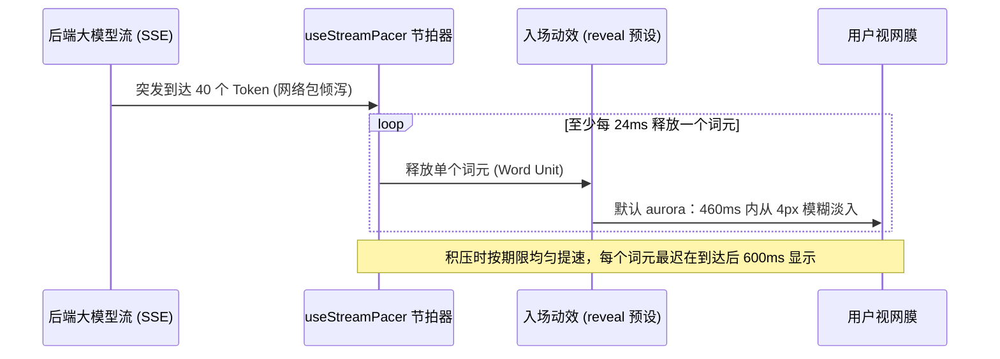

# 第六篇：AI 原生交互、流式节拍与防抖渲染 (AI Native Interfaces & Streaming)

> 涵盖章节：第 31 章 ～ 第 33 章  
> 核心主题：大模型流式 Token 到达节拍器；双层镜像 Reserve 防抖渲染；零阻塞用户阅读与即时框选底线。

---

## 第 31 章：流式文字节拍器：Pacer 架构与微渐显

### 31.1 大模型流式输出的“网络脉冲抖动”

现代大语言模型（LLM）与后端推理服务的输出具有极强的非均匀性（Burstiness）：
* 偶发性卡顿（Time-To-First-Token 延迟、网络丢包）。
* 突发性倾泻（一次 SSE 数据包整块到达数十个字符）。

如果前端收到什么就直接粗暴地渲染到 DOM 上，文字在屏幕上会表现为“卡死 1 秒后瞬间暴雨般刷出一大坨”，给用户带来强烈的机械失控感。

### 31.2 `useStreamPacer` 节拍器调度模型

TuffEx 的 `TxStreamText`、`TxCodeStream` 与 `TxStreamElement` 共享同一个核心时钟调度器。`TxStreamText` 内部这样调用它（节选）：

```ts
// 节拍参数取自 props，不传时用 STREAM_PACING_DEFAULTS
const pacer = useStreamPacer({
  total: () => available.value,     // 已到达的词元数
  streaming: () => props.streaming, // 源是否仍在输出
  wordMs: () => props.wordMs,       // 默认 24：至少每 24ms 释放一个词元
  maxLagMs: () => props.maxLagMs,   // 默认 600：每个词元最迟在到达后 600ms 显示
  drainMs: () => props.drainMs,     // 默认 320：源结束后，剩余积压在 320ms 内出清
  pauseMs: () => props.pauseMs,     // 默认 400：源未结束、400ms 没有词元可放，状态记为 paused
})
```

* **正常阶段**：至少每 24ms 释放一个词元。
* **持续追赶**：流式期间，释放速率取「1 ÷ wordMs」与「积压 ÷ 最老未显示词元剩余的期限」中较大的一个，期限是它的到达时间加 `maxLagMs`（600ms）。整段积压在这个期限前均匀放完，突发读起来是一段加快的字流，而不是一次砸下一大块；源一直快过 24ms 一个词元时，显示延迟稳定在略低于 600ms。
* **收尾**：源结束的那一刻，速率定为「1 ÷ wordMs」与「积压 ÷ drainMs」中较大的一个，剩余积压在 320ms 内放完。
* **暂停**：源仍在输出、显示已追平且 400ms 没有新的释放时，状态变为 `paused`。光标的外观不随状态变化，任何实时状态下都是同一个环绕加呼吸的动画。
* **末词等待**：`TxStreamText` 会留住最后一个还没写完的词，等到空白、收尾标点，或源安静 200ms 后再放出。

`useStreamPacer` 也从 `stream-text` 导出，可以单独使用，`total` 与 `streaming` 两项必填。



### 31.3 微渐显预设（Reveal Presets）与光标交接

文字到达后，可配置微妙的视觉涌现风格：
* `aurora`（默认，460ms）：从 4px 模糊中淡入，颜色同时由蓝经紫、粉扫到正文墨色。
* `hue`（180ms）：同样的淡入与色彩扫过，但没有模糊。
* `blur`（420ms）：只从 4px 模糊中淡入，不带颜色。
* `languid`（900ms）：从 8px 模糊中淡入，同时上浮 4px。
* `none`（0ms）：纯文本瞬间呈现（零额外开销）。

系统开启「减弱动态效果」时，`TxStreamText` 跳过节拍、不播放入场，文字一到达就以最终样式出现。

**光标交接原则**：
当一段文字由多个 Markdown 块（段落、列表、代码块）组合时，**整屏只允许存在一个全局激活光标**。后序块接管光标时，前序块的光标必须瞬间静默隐藏，严禁出现“全屏十几个光标同时闪烁”的丑陋状态。

---

## 第 32 章：流式生成中的稳定高度与防跳动

### 32.1 生成过程中的滚动条癫痫

在传统的聊天或问答界面中，随着大模型不断吐字，容器高度每秒发生十几次微小变化，导致浏览器滚动条不断伸缩，视口文字上下狂跳，用户甚至无法安稳阅读当前行。

### 32.2 双层镜像占位（The Reserve Layer Technique）

TuffEx 在 `TxStreamText` 与 `TxStreamElement` 中都引入了**双层镜像几何技术**：

```
+----------------------------------------------------+
| 外部 Grid 容器 (尺寸由内容最大者决定)             |
|                                                    |
|  [正在流式生成的活动层 (Live Layer)]               |
|  以极短过渡平滑吐字，完全可见可交互                |
|                                                    |
|  [后台隐形预占位层 (Reserve Copy Layer)]           |
|  aria-hidden="true" inert visibility: hidden       |
|  重放时预先占住完整内容的尺寸，锁定最终高度        |
+----------------------------------------------------+
```

1. **预占位层（Reserve Layer）**：在重放或已知完整尺寸的交互中，挂载 `aria-hidden="true"`、`inert` 与 `visibility: hidden`，对无障碍读屏器与鼠标完全隐身，但在排版引擎中占有实际物理网格。
2. **边缘修剪（Edge Trimming）**：`TxStreamElement` 的两层都去掉首个子项的 `margin-top` 与末个子项的 `margin-bottom`，让占位层与它撑住的回答量出同样的高度。`TxStreamText` 是一段行内文字，用 `inline-grid` 叠放两层，没有外边距要修。
3. **适用范围**：这只在重放已完成的内容时生效，而且 `reserve` 默认关闭：真正实时流式输出（包括重新生成）时最终高度还不知道，容器仍会随内容增高。
4. **代码流**：`TxCodeStream` 也有 `reserve`，但不用镜像：完整代码的行数已知，重放时直接按总行数撑住代码区的高度。

---

## 第 33 章：可交互性底线：动画绝不阻断阅读与复制

### 33.1 永远将用户控制权置于动效之上

在很多华而不实的产品中，开发者常常给流式文字套上沉重的容器遮罩，甚至给正在打印的段落加上 `user-select: none` 或指针阻拦，强制用户“必须等我把炫酷的打字机特效演完才能复制”。
**这是极其傲慢的设计倒退，严重践踏了工具型软件的效率准则**。

### 33.2 TuffEx 交互底线铁律

1. **文字即刻落定（Instant DOM Availability）**：
   任何一个词元被释放到 DOM 树的瞬间，它就是一个普通的文本节点。用户可以在任何毫秒随时按下鼠标框选、按下 `Cmd+C` 复制已经呈现的部分。
2. **严禁指针拦截**：
   流式微渐显特效只能挂在纯视觉表现层，严禁任何遮挡点击事件的透明全屏蒙版。
3. **极速跳过能力（Skip on Interrupt）**：
   TuffEx 本身不监听滚动、点击或 ESC，何时跳过由宿主决定：`TxStreamText` 与 `TxStreamElement` 都通过 ref 暴露 `skip()`，宿主在用户快速滚动、点击底部区域或按下 ESC 时调用它即可。`skip()` 是同步的：调用当下就显示全部内容、不再播放入场，不必等下一帧。
4. **无障碍即时呈现**：
   减弱动态效果开启时，节拍器与入场动效全部旁路，保持最纯粹的即时阅读通道。读屏器无法从页面里探测，TuffEx 不为它单独旁路节拍；流式期间容器带 `aria-busy="true"`，告诉辅助技术内容还在更新。
