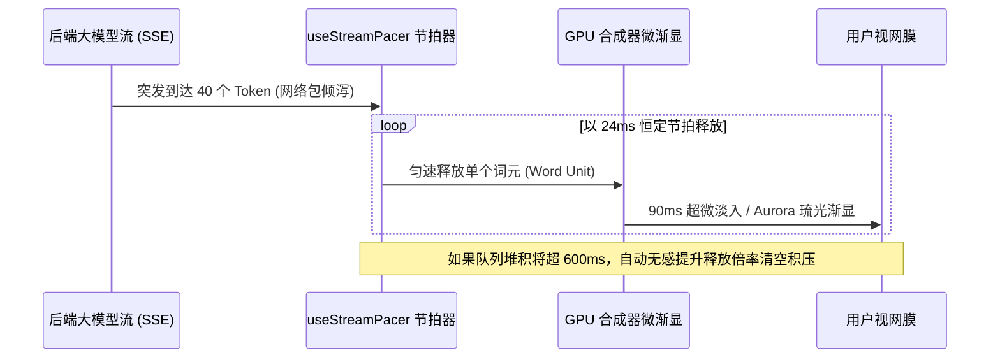

# 第六篇：AI 原生交互、流式节拍与防抖渲染 (AI Native Interfaces & Streaming)

> 涵盖章节：第 31 章 ～ 第 33 章  
> 核心主题：大模型流式 Token 到达节拍器；双层镜像 Reserve 防抖渲染；零阻塞用户阅读与即时框选底线。

---

## 第 31 章：流式文字节拍器：Pacer 架构与微渐显

### 31.1 大模型流式输出的“网络脉冲抖动”

现代大语言模型（LLM）与后端推理服务的输出具有极强的非均匀性（Burstiness）：
* 偶发性卡顿（Time-To-First-Token 延迟、网络丢包）。
* 突发性倾泻（一次 SSE 数据包整块到达数十个字符）。

如果前端收到什么就直接粗暴地渲染到 DOM 上，文字在屏幕上会表现为“卡死 1 秒后瞬间暴雨般刷出一大坨”，给用户带来强烈的机械失控感。

### 31.2 `useStreamPacer` 节拍器调度模型

TuffEx 的 `TxStreamText`、`TxCodeStream` 与 `TxStreamElement` 共享同一个核心时钟调度器：

```ts
// 节拍器状态机时序核心原则
useStreamPacer({
  wordMs: () => 24,    // 基准节拍：每 24ms 释放一个单词/字符单元
  maxLagMs: () => 600, // 延迟上限：任何堆积的字符如果在队列停留超过 600ms，强行提速追赶
  drainMs: () => 320,  // 排空时间：后端流断开后，在 320ms 内匀速释放剩余全部缓冲
  pauseMs: () => 400,  // 停顿判定：400ms 无新 Token 进入进入 'paused'，光标原地等待呼吸
})
```



### 31.3 微渐显预设（Reveal Presets）与光标交接

文字到达后，可配置微妙的视觉涌现风格：
* `aurora`（460ms）：琉光微晕，字形伴随微弱色散由虚入实。
* `blur`（420ms）：模拟墨水在宣纸上由模糊到锐利的物理扩散。
* `hue`（180ms）：轻量冷调色相滑入。
* `none`（0ms）：纯文本瞬间呈现（零额外开销）。

**光标交接原则**：
当一段文字由多个 Markdown 块（段落、列表、代码块）组合时，**整屏只允许存在一个全局激活光标**。后序块接管光标时，前序块的光标必须瞬间静默隐藏，严禁出现“全屏十几个光标同时闪烁”的丑陋状态。

---

## 第 32 章：流式生成中的稳定高度与防跳动

### 32.1 生成过程中的滚动条癫痫

在传统的聊天或问答界面中，随着大模型不断吐字，容器高度每秒发生十几次微小变化，导致浏览器滚动条不断伸缩，视口文字上下狂跳，用户甚至无法安稳阅读当前行。

### 32.2 双层镜像占位（The Reserve Layer Technique）

在 `TxStreamElement` 中，TuffEx 创造性地引入了**双层镜像几何技术**：

```
+----------------------------------------------------+
| 外部 Grid 容器 (尺寸由内容最大者决定)             |
|                                                    |
|  [正在流式生成的活动层 (Live Layer)]               |
|  以极短过渡平滑吐字，完全可见可交互                |
|                                                    |
|  [后台隐形预占位层 (Reserve Copy Layer)]           |
|  aria-hidden="true" inert visibility: hidden       |
|  预先计算整块排版几何，消除高度突跳                |
+----------------------------------------------------+
```

1. **预占位层（Reserve Layer）**：挂载 `aria-hidden="true"`、`inert` 与 `visibility: hidden`，对无障碍读屏器与鼠标完全隐身，但在排版引擎中占有实际物理网格。
2. **边缘修剪（Edge Trimming）**：通过样式强制修剪第一项的 `margin-top` 与最后一项的 `margin-bottom`，确保两层在任何行高下像素级绝对对齐。
3. 用户回放或重新生成时，视窗高度由预先测定的几何牢牢锁定，彻底根除了滚动条跳动。

---

## 第 33 章：可交互性底线：动画绝不阻断阅读与复制

### 33.1 永远将用户控制权置于动效之上

在很多华而不实的产品中，开发者常常给流式文字套上沉重的容器遮罩，甚至给正在打印的段落加上 `user-select: none` 或指针阻拦，强制用户“必须等我把炫酷的打字机特效演完才能复制”。
**这是极其傲慢的设计倒退，严重践踏了工具型软件的效率准则**。

### 33.2 TuffEx 交互底线铁律

1. **文字即刻落定（Instant DOM Availability）**：
   任何一个词元被释放到 DOM 树的瞬间，它就是一个普通的文本节点。用户可以在任何毫秒随时按下鼠标框选、按下 `Cmd+C` 复制已经呈现的部分。
2. **严禁指针拦截**：
   流式微渐显特效只能挂在纯视觉表现层，严禁任何遮挡点击事件的透明全屏蒙版。
3. **极速跳过能力（Skip on Interrupt）**：
   当用户快速滚动屏幕、点击底部或者按下任意交互按键时，系统提供 `skip()` 信号，瞬间排空剩余所有节拍动画，在 1 帧内（16ms）直接将最终全量文本渲染完毕。
4. **无障碍即时呈现**：
   在读屏器（Screen Reader）模式与减弱动态效果下，绕开所有节拍器延迟，保持最纯粹的即时阅读通道。
