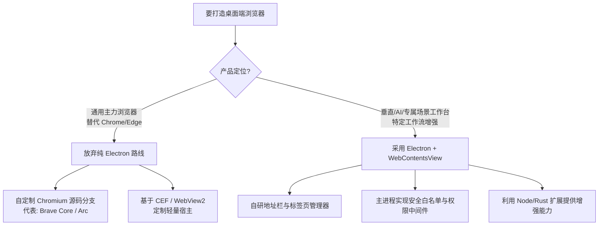

# Electron 构建浏览器可行性与兼容性调研报告

> 日期：2026-10-17  
> 状态：调研完成；作为底层技术选型参考与风险定界，未进入实施阶段。  
> 背景：评估基于 Electron 打造桌面端 Web 浏览器（通用主力浏览器 vs. 垂直工作流/AI 浏览器）的兼容性、技术壁垒与架构约束。

---

## 1. 核心结论与选型定界

| 目标形态 | 可行性 | 推荐程度 | 核心判断与边界 |
|---|---|---|---|
| **通用桌面主力浏览器** *(目标：替代 Chrome/Edge，支持全量插件与日常综合冲浪)* | ❌ 极低 | **强烈不推荐** | **存在不可逾越的生态断层**。Chrome 扩展生态（MV3/Adblock/钱包）、商业 DRM、自动填充和权限系统在 Electron 中严重缺失或残缺，工程维护成本呈指数级发散。 |
| **垂直/AI/工作流浏览器** *(目标：受控网页工作台、网页上下文提取、AI Agent 协同、企业内嵌)* | ✅ 极高 | **推荐** | **最快交付路径**。避开全量通用扩展和复杂消费级媒体需求，充分复用 Node.js/Rust 跨进程能力、主进程网络钩子与前端 UI 自由度。 |

---

## 2. 关键能力差距与技术壁垒矩阵

| 维度 | 原生 Chromium (Chrome/Edge/Brave) | Electron (`WebContentsView` / Session) | 对做浏览器的影响与差距 |
|---|---|---|---|
| **Chrome 扩展 (MV3)** | 完整支持 Manifest V2 / V3 全部规范及扩展商店 | 仅支持有限的 DevTools 调试扩展和少部分基础 `chrome.runtime` / `chrome.storage` API | **致命**。uBlock Origin（依赖 `declarativeNetRequest`）、MetaMask、Bitwarden、Tampermonkey 等核心扩展无法稳定运行。 |
| **受保护多媒体 (DRM)** | Google 官方授权 Widevine CDM 完整内置与签名验证 | 默认不包含 Widevine（无 Google 分发授权），官方已停止支持简易嵌入构建 | **致命**。Netflix、Spotify Web、Disney+ 及国内爱奇艺/腾讯/B站受版权保护的视频直接黑屏或报错。 |
| **表单与密码 (Autofill)** | 内置强大的凭据、地址、信用卡自动识别与一键填充 | **完全为零** | 必须由主进程注入脚本并自建数据库自行实现密码学存储、匹配与浮窗渲染。 |
| **权限管理体系 (Permissions)** | 拥有完整的地址栏权限请求气泡、单次/永久授权与持久化数据库 | 默认全部拒绝或全部放行；仅提供底层 Hook（`setPermissionRequestHandler` 等） | 摄像头、麦克风、地理位置、屏幕共享、剪贴板等所有授权弹窗及白名单均需手写业务层管理逻辑。 |
| **系统安全硬件认证** | 深度打通 OS Keychain / Passkeys / WebAuthn / Windows Hello / 智能卡 | 需主进程挂载网络/设备事件或自编译 Native 模块桥接 | 现代免密登录、硬件 UKey 和企业 mTLS 认证无法开箱即用。 |
| **多标签页资源优化** | 具备内核级 Tab Discarding（标签页冻结、内存压缩回收与静默恢复） | 每个 Tab 即一个渲染进程，缺乏统一的页面生命周期回收控制器 | 开 20~30 个标签页内存容易膨胀到数 GB，需要应用层手写视图销毁与快照重建逻辑。 |
| **原生交互控件** | 原生打印预览 (Print Preview)、页面搜索 (Ctrl+F)、下载气泡管理器 | 无内置 UI。只有底层方法 (`webContents.print`, `findInPage`, `will-download`) | 必须由前端自研全套下载列表、搜索浮窗和打印预览层。 |
| **内核更新时效** | 随 Chromium 发版即时更新 | 通常滞后 Chromium Stable 1~2 个大版本 | 最前沿的 Web Platform 规范（如最新 WebGPU 规范、新 CSS 伪类）存在版本时滞。 |

---

## 3. 核心风险深度剖析

### 3.1 Chrome 扩展生态（最深鸿沟）
1. **API 支持面极窄**：Electron 的扩展子系统设计初衷是让开发者能在开发阶段加载 React Developer Tools、Vue Devtools 等调试插件，从未打算对齐消费级 Chrome 扩展的完整运行环境。
2. **缺乏核心命名空间**：
   * 缺少完整的 `chrome.tabs.*`、`chrome.windows.*`、`chrome.contextMenus.*`。
   * 缺少 `chrome.declarativeNetRequest.*`（现代 MV3 广告拦截器的根基）。
   * 缺少 Extension Action 相关的标准弹出层（Browser Action Popup）、侧边栏（Side Panel API）。
3. **安全沙箱不一致**：原生扩展拥有专属的独立进程空间与隔离 DOM 世界（Isolated World），Electron 中扩展脚本注入和主进程通信存在上下文隔离配置冲突的隐患。

### 3.2 商业版权保护媒体（DRM / Widevine）
1. **授权壁垒**：Google Widevine CDM 属于专有商业授权组件。未获 Google 授权的第三方二进制分发无法合法携带最新版 CDM。
2. **签名核验失败**：即使从本地已安装的 Chrome 目录强行复制 `.plugin` 或 `.dll` 到 Electron 并在启动参数中挂载，新版 Widevine 增加了对宿主可执行程序（Host Executable）的代码签名哈希校验，未签名的 Electron 二进制文件会被 CDM 直接拒绝加载。

### 3.3 进程与视图管理（UI 架构与内存）
1. **视图合成问题**：
   * 承载第三方 Web 页面必须使用 `WebContentsView`（旧版 `BrowserView` 已处于废弃轨道；`webview` 标签因严重性能与安全漏洞已被官方不建议使用）。
   * `WebContentsView` 是系统原生视图容器，独立于 Electron 自身的 DOM 渲染树。这意味着应用自身的网页 UI（如地址栏下拉联想、多级浮动菜单）如果覆盖在 `WebContentsView` 区域上方，处理坐标同步、图层遮挡和窗口缩放时极易产生闪烁或黑边穿透。
2. **标签页生命周期与内存管理**：
   * Chromium 原生支持基于 LRU、内存压力事件的页面冷冻与重载机制。
   * Electron 内若保持多个活跃的 `WebContents`，Node 绑定与 Chromium 渲染管线常驻，如果不开发“冻结快照 + DOM 卸载 + 重新激活按需还原”机制，多任务并发时宿主资源消耗极大。

---

## 4. 行业先例复盘与架构路线对比

### 行业典型教训：Brave 的技术重构
* **2016 ~ 2018 年（Muon 架构）**：Brave 最早基于定制版 Electron（命名为 Muon）开发浏览器。当时试图在 Electron 之上补充 Chrome 扩展和安全隔离机制。
* **遭遇困境**：发现每次 Chromium 上游发版合并需要投入海量人力维护私有补丁；扩展兼容性始终千疮百孔，性能大幅落后原生 Chrome。
* **2018 年推翻重构（Brave Core）**：彻底推翻 Muon，直接拉取 Chromium C++ 官方源码建立定制分支，将 Brave 的功能（钱包、Shields 拦截器）通过 Chromium 原生 C++ 组件补丁的形式嵌入编译。

---

## 5. 建议与决策依据

1. **若当前评估意图为通用浏览器**：
   * **决策**：直接终止使用标准 Electron 研发的技术探索。
   * **正规路线**：组建 C++ / Chromium 研发管线，基于 Chromium upstream 建立 fork，或基于 CEF (Chromium Embedded Framework) 定制。

2. **若当前评估意图为 Tuff 体系内的“增强型工作台 / 内嵌浏览器 / AI 伴侣浏览”**：
   * **决策**：完全可行且收益明显。
   * **实施边界**：
     * 不承诺兼容任意 Chrome 扩展商店插件，必要功能（如去广告、密码填充）由官方以受控插件或系统原生集成方式提供。
     * 第三方网页一律承载在隔离的 `WebContentsView`，通过主进程 `session` 统一接管网络、Cookie、代理和权限校验。
     * 设计 Tab 挂起机制，仅保留最近活跃的 N 个活跃视图，非活跃视图暂存 URL 与历史堆栈，避免内存无节制增长。
