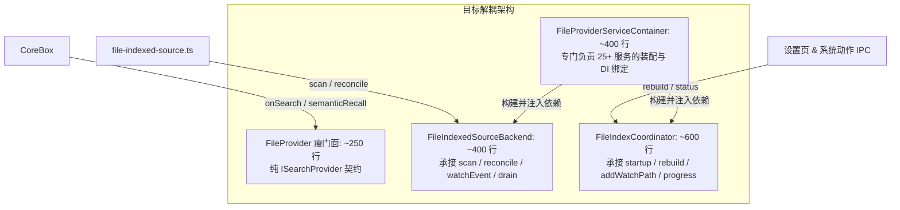

# FileProvider 巨石架构深拆分析与演进方案

> 日期：2026-10-18  
> 关联任务：[TODO-BACKLOG-LONG-TERM.md](../../plan-prd/TODO-BACKLOG-LONG-TERM.md#a-架构与质量债务)（SRP Wave C）  
> 涉及文件：`apps/core-app/src/main/modules/box-tool/addon/files/file-provider.ts`（当前 4,073 行）  
> 关联报告：[`search-crossplatform-audit.md`](./search-crossplatform-audit.md)、[`file-search-integration-2.5.1-2026-10-11.md`](./file-search-integration-2.5.1-2026-10-11.md)

---

## 一、背景与问题核查

在 SRP Wave C 治理中，`file-provider.ts` 目前代码量达 **4,073 行**。经工程核查，此前历史提交中**已经抽离出 20 余个独立子服务与专用 Worker 线程**，包括：

1. **文件监听**：`FileProviderWatchService`、`file-watch-subtree-service.ts`、`FileProviderWatchSubtreeReconcileService`；
2. **内容提取与策略**：`FileProviderContentIndexPolicyService`、`FileProviderContentCapacityService`、`FileProviderIndexSchedulerService`、`FileProviderIndexRuntimeService`、`FileProviderEnrichmentResumeService`、`FileIndexWorkerClient`（Worker 线程）；
3. **向量化**：`EmbeddingService`、`FileProviderEmbeddingIndexService`；
4. **电池状态**：`deviceIdleService`（全局服务）。

### 为什么抽离后依然膨胀到 4,073 行？

代码 AST 与方法调用频次证明：**“子服务抽离了底层算法，但宿主类未做职责剥离，把所有的依赖装配胶水、跨服务状态同步、分库分支和控制面 IPC 全都留在了 `FileProvider`”**。

```
file-provider.ts (4,073 行)
├── 1. 构造函数依赖注入样板（第 555-1118 行，整整 563 行）
│   └── 实例化 25+ 个子服务，给每个子服务手写长达数十行的匿名闭包回调。
├── 2. 扫描与遍历落盘管线（约 1,000 行）
│   ├── _initialize（140 行）、rebuildIndex（113 行）、startIndexing（82 行）
│   └── persistAndPublishFullScanBatch（73 行）、persistSubtreeRecordBatch（71 行）、persistReconciledUpdates（44 行）
├── 3. 增量变更与文件记录构建（约 600 行）
│   ├── persistIncrementalRecords（84 行）、buildFileRecord（68 行）、handleIncrementalAddsOrChanges（57 行）
│   └── 包含大量 stat 探测、扩展名提取、NFC/NFD 路径比对及 LibSQL 批量执行逻辑。
├── 4. 历史版本迁移与 Backfill 残留（约 350 行）
│   ├── schedulePathNormalizationMigration / rewriteFilePathToNormalizedForm（NFC 路径修正）
│   └── scheduleKeywordSchemaBackfill / loadKeywordBackfillRowsPage（关键词版本升 V3 回填）
└── 5. 控制面 IPC 事件中继与流式广播（约 500 行）
    ├── registerProgressStream（131 行！进度计算、节流与 StreamContext 销毁）
    └── addWatchPath（95 行）、registerOpenersChannel（45 行）、状态与证据导出（80 行）
```

---

## 二、角色解耦模型（4 角色分离）

`FileProvider` 当前揉杂了 4 种不同维度的系统角色，演进目标是将门面缩减至 **300 行以内**：



| 角色 | 目标单元 | 承担职责与方法 | 预估行数 |
|---|---|---|---|
| **搜索门面** | `FileProvider` | `onSearch`、`onExecute`、`semanticRecall`、`hasSearchFilters`、`resolvePreviewResourcePath`、`resolveIndexedActionPath` | ~250 行 |
| **索引源后端** | `FileIndexedSourceBackend` | 专职对接 `file-indexed-source.ts`：`scan`、`reconcile`、`handleWatchEvent`、`drainMutations`、`resetRuntimeState` | ~400 行 |
| **引擎协调器** | `FileIndexCoordinator` | 控制面调度：`startIndexing`、`rebuildIndex`、`addWatchPath`、`registerProgressStream`、`getContentIndexSettings` | ~600 行 |
| **依赖装配工厂** | `FileProviderServiceContainer` | 25+ 个子服务实例化与参数组装，收敛 560+ 行 constructor 匿名闭包 | ~400 行 |

---

## 三、平滑优化演进路线

采用增量重构，每一步可独立提交、独立运行测试，禁止破坏既有并发与持久化保证：

### Step 1：抽离依赖装配工厂（收益：立即减少 ~560 行，风险：零）
- **操作**：创建 `file-provider-service-container.ts`，将 `FileProvider` constructor 中实例化子服务及匿名配置对象的代码移入 `createFileProviderServices(deps)`。
- **效果**：`file-provider.ts` 从 4,073 行直接降至 ~3,500 行。纯代码位置搬移，不改任何调用链与状态机，测试 100% 通过。

### Step 2：历史迁移任务闭环下沉（收益：减少 ~350 行，风险：极低）
- **操作**：把 `loadPathNormalizationRowsPage`、`rewriteFilePathToNormalizedForm`、`emitKeywordBackfillRows` 等底层 SQL 分页与重写逻辑，彻底移入对应已存在的 `FileProviderPathNormalizationService` 和 `FileProviderKeywordBackfillService`。
- **效果**：`FileProvider` 不再充当迁移脚本的执行器，仅保留调度触发入口。

### Step 3：分库双拓扑持久化收敛（收益：减少 ~300 行样板，风险：低）
- **操作**：抽象轻量级 `FilePersistenceRouter`，把贯穿各处的 `this.isSearchSplitEnabledNow() ? searchIndexWriter.execWrite(...) : scheduleDbWrite(...)` 收敛成统一的 `persist(label, sql, mode)` 调度器。
- **效果**：消除全量扫、增量扫、文件删除、元数据更新等十多处重复的条件分支。

### Step 4：彻底剥离搜索 Provider 与索引协调引擎（收益：终态架构，风险：中）
- **操作**：
  1. 将全量扫描批处理落盘（`persistAndPublishFullScanBatch`）与增量变更（`persistIncrementalRecords`）移入 `FileIndexPipelineCoordinator`；
  2. 让 `file-indexed-source.ts` 直接挂接 `FileIndexedSourceBackend`，解除对整个 `FileProvider` 神级对象的直接引用；
  3. `FileProvider` 蜕变为纯粹的只读搜索 Provider。

---

## 四、重构必须遵守的三条工程不变量（Invariants）

在执行上述分阶段优化时，必须死守以下底线：

1. **AIMD 批调度与退避契约不变**：`upsertBatchScheduler` 的 10 条上限、慢批次 ≥250ms backoff、以及 `waitForIdle` 机制必须原封不动保留，不能因分层解耦破坏写入让步。
2. **`mutationLease` 取消屏障不变**：超时或取消时调用 `markContentEnrichmentPending` 标记待恢复行的机制必须严格保留，杜绝任务中断时的数据静默丢失。
3. **主库与搜索库 ID 防碰撞隔离不变**：在 Split DB 模式下，搜索库持久化必须只消费搜索库的自增 row ID，严防主库 ID 穿透导致的错位更新。
