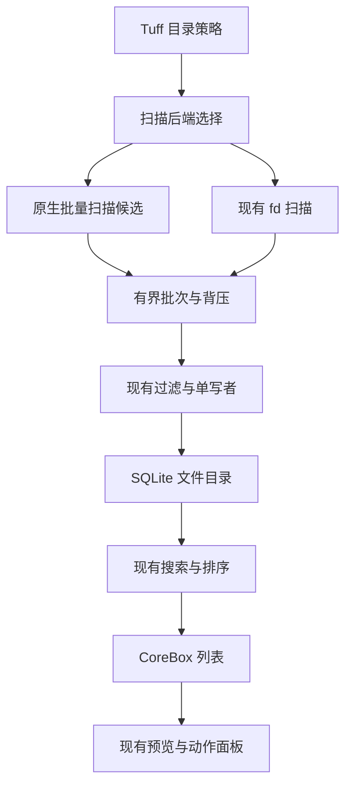

# Tuff 2.5.1 文件搜索与文件动作融合调研

> 日期：2026-10-11
> 目标版本：**2.5.1**
> 状态：**P0 已实现（单元测试与类型检查通过）**；P1–P4 及跨平台打包真机验收待实施。
> 范围：everyfiles、fsearch 的接入价值，以及用户提供的搜索列表、文件动作与预览截图。
> 执行入口：[当前执行顺序](../../plan-prd/TODO.md)。本文记录 2.5.1 的局部范围与验收条件，不改变全局执行优先级。

## 1. 结论与版本范围

先补文件动作体验，再评估 everyfiles 的批量扫描能力。暂不整套接入 fsearch，也不同时启动三套文件索引与监听。

用户已将本次分析列为 **2.5.1 待做事项**。下文的动作整合、扫描实验、名字加速评估、文件变更操作和显式源码正文检索均登记为待实施。技术选型仍须满足各阶段验收条件；版本标记不代表承诺两个上游引擎完整上线。

截图展示的是“搜索结果 → 文件动作 → 预览”的产品体验。两个 Rust 仓库提供搜索引擎，不提供这套界面。界面补齐和引擎接入可以独立推进。

| 对象 | 推荐融入 | 暂不融入 | 判断依据 |
| --- | --- | --- | --- |
| 截图交互 | 文件动作分组、操作筛选、选中文件摘要 | 全量照搬菜单、重做 CoreBox | Tuff 已有结果列表、预览和 ⌘K 面板 |
| everyfiles | 批量目录枚举；后续评估名字索引 | 立即替换现有搜索与监听 | 跨平台结构清楚，但匹配语义不等价 |
| fsearch | 模糊召回思路；显式源码正文检索候选 | 默认常驻、全盘扫描、自动正文索引 | macOS 专属，默认策略与 Tuff 冲突 |

本轮调研阶段未安装守护进程、未启动全盘扫描；随后落地的 2.5.1 正文分段与受控本地语义链路见 §2.5.1 DigUp 语义穿透落地边界。正式目录不导入本地索引、日志、临时 profile 或构建产物。

## 2.5.1 DigUp 语义穿透落地边界（2026-10-11）

本轮把 DigUp 的可复用部分落到 Tuff 的现有单写者边界：PDF.js 按真实页解码，代码按行分段；分段正文以受控 `content_chunks` 元数据跟随文件正文持久化，EmbeddingGemma 2 的每个向量携带分段 hash，召回后由同一分段生成页码/行号、摘要和 UTF-16 高亮范围。关闭正文索引时，正文、分段、向量和正文进度一起清理；普通文件名搜索不读取这些正文元数据。

DigUp 的模型事实已按上游源码固定：`google/embeddinggemma-2`，`ggml-org/embeddinggemma-2-GGUF` revision `bfcd298762cc34d0357ece5ebdd31791a3a374d8`，文本 Q8_0 文件 309,855,456 bytes，向量 768 维。Tuff 接受显式 helper／SHA-256／模型目录环境配置，或固定平台用户数据目录下 `Tuff/intelligence/local-embedding.json` 的受控安装记录；记录须匹配版本、平台和架构，helper 与模型目录须为绝对路径，helper SHA 与固定模型 SHA 在启动前校验。显式 helper 配置不能借用安装记录的 SHA；普通搜索不隐式下载模型或递归扫描用户目录。PDF 外部精确页码打开只承诺 Skim deep link；Preview 的搜索框不会被 Tuff 当作已验证的自动跳页能力。

图片编码已在 2026-10-12 补齐受控实现与真实模型验收；音频、视频、扫描 PDF OCR、媒体时间点跳转和生产打包 helper 仍未验收。固定图像投影权重 `mmproj-embeddinggemma-2-Q8_0.gguf` 为 554,821,024 bytes，SHA-256 为 `c4a8a52691ecef40618438928bdf9e68379b854e24166f292592353db0aab64f`，与文本模型同 revision／768 维空间。权重与 helper 必须由显式环境配置或受控安装记录发现；缺图像编码器不破坏文字能力，不自动下载或上传图片。

补证结果：真实四页 PDF → mapper/repository → 固定版 EmbeddingGemma 2 → split 单写者事务 → SQLite 关闭重开 → `semanticRecall`，已断言第 4 页 hash 与完整条款一致；关闭正文后的实际清理保留目录元数据。新增永久回归验证共享库模式的第二条向量插入失败会整体回滚，以及 cleanup 在 preflight 与 worker 批事务之间提交时，晚到向量不会复活。

原生定位已实跑：官方 Skim 1.7.17 以临时只读挂载方式打开 `skim:///…#page=4`，AppleScript 读回页码 4/4 与宠物条款，目标窗口截图一致；Zed 用 bundle CLI 打开独立 100 行样本，光标与状态栏为 50:1。验证后关闭自建窗口、退出临时 Skim 并卸载卷，未永久安装查看器、未修改默认关联。HomePage 真实 Vue 组件在浏览器隔离状态样本中显示错误代码、原因与重试；空详情显示 `UNKNOWN_ERROR`。这项 UI 验证不代表接通正式 Electron transport。

2026-10-12 图片补证：原本已入目录却以 `content-indexing-disabled` 跳过的真实 PNG，经实际 worker 输出无正文 `pending`、repository 持久化、host-only SDK 安全图片快照、本地模型、split 单写者、SQLite 关闭重开，再由实际 `semanticRecall` 返回原路径。`猫`、`宠物`、`一只猫`、`a pet cat` 在含无关会计文本的样本中均把猫图排首位，相似度分别为 0.7231／0.6728／0.7088／0.7175；primary 向量表为空，图片 `content=NULL`，没有手工描述或虚构分段，删除图像向量后不再召回。

本地查询按该固定模型官方任务格式 `task: search result | query: …` 编码，不能把无提示词的原始短词当作模型的检索任务。搜索内核与文件层共用汉字短词门禁；语义任务从首帧后启动，完成或取消后再结束当前会话，避免迟到向量被终态丢弃。已显示的结果仍只追加，不重排。实际设置组件保留关闭默认值并说明图片读取与本地编码器前提；未重启用户 dev，未写正式 profile，这些隔离证据不证明当前旧进程已加载新主进程代码。

2026-10-12 当前进程补证：内容索引设置已开启，但正式库的目标 PNG 仍为 `content-indexing-disabled` 跳过状态，图片向量为 0。该 dev 进程没有配置 helper 路径、helper SHA-256 或模型目录，图像能力门禁因而不准入补齐。隔离模型验收不证明正式实例具备这些前提；实际 CoreBox 图片召回仍待明确授权重启并配置后验收。

同轮缩小前缀查询的关键词索引范围，使用显式 BM25 的 FTS rank 游标，并把向量扫描和评分移到独立 semantic 读线程。真实 worker 在正式库只读查询中测得：前缀旧语句首次 397 ms，随后范围查询 16 ms（包含不同缓存状态，不作严格性能比例）；暖 FTS 外部排序 62 ms，rank 游标 17 ms。这些是原生 SQL 请求耗时，不含用户进程的历史排队等待，也不代表截图中的 3 秒超时已在正式实例消失。

修正后的完整隔离模型验收再次返回同一原图。模型已加载时，`猫`、`宠物`、`一只猫` 和 `a pet cat` 耗时为 47、14、11 和 9 ms；图片首次编码另耗时 1611 ms，属于后台索引。正式向量库的独立线程只读扫描为 290 ms；同一隔离 Node 宿主的 10 ms 心跳最大间隔为 16 ms。12 个套件／211 项回归、Node 类型检查和相关 ESLint 通过。未写正式 profile、未启动第二 Electron；上述心跳不替代正式主进程或渲染进程的交互验收。

截图原查询 `cat` 也已单独实跑：配置本地模型后，实际 `semanticRecall` 首位返回原图，相似度为 0.7299，含新读线程启动的召回耗时为 41 ms。图片正文仍为 NULL，删除向量后不再召回。此补证仍使用隔离数据库，正式图片尚未补齐。

正常启动接线补证（2026-10-12）：用户明确授权把已有权重和 helper 迁入稳定 Tuff 应用数据目录，并重启当前唯一 dev；迁移没有下载或保留重复权重。清空全部本地模型环境变量后，实际 runtime 自动发现安装记录，原猫图生成 768 维向量，`cat` 相似度 0.7299。正式实例已开始按原授权目录有界补建图片；旧目标图片仍须等其真实向量发布后验证 CoreBox 召回，不能把安装就绪当成目标已可搜。

同轮删除「最近处理」面板、入口、历史快捷键、专用焦点及采集／保存路径；保留计算／换算／二维码预览、复制执行路径和普通剪贴板历史。正式 Electron 中 `2 + 2` 仍显示结果 4，历史面板节点为 0，截图没有右侧历史空栏。Node／Web 类型检查通过，CoreApp 9 套件／212 项与 Utils 51 项回归通过。

正式原图闭环（2026-10-12 后续）：正常后台队列中旧原图仍被跳过；已有手动添加入口只按元数据变化产生增量，不能刷新未变文件。用户授权修复局部刷新后，未变且准入的手动文件保留原行，在同一 Runtime mutation lease 内把旧跳过进度恢复为 pending，再沿原 writer ack／worker／SDK／单写者处理。内容授权关闭时不恢复内容任务；原文件和目录规则不变，不用全库重建。原图正式向量由该正常链路实际写入，`files.embedding_status=completed`、`content=NULL`、向量 1 行。

另有显示门槛：首屏字面候选达到 20 条就跳过整个语义阶段，应用候选也会挡住图片。移除此总数门槛，仍保留短词资格、显式 Provider scope、取消、首屏后执行及追加去重；不重排已显示项目。正式库的独立语义读线程将原猫图列为 `cat` 第 1 名，分数 0.7299。当前唯一正式 dev 的真实 CoreBox 输入 `cat` 后，原文件名进入实际 DOM 结果列表，当次为 854 ms，历史面板节点为 0。为避免自动失焦隐藏打断协议验收，只临时固定窗口，完成后恢复并隐藏；此证据不代表原生全局键盘焦点已重新验收。语义结果追加于已有字面结果之后，不承诺 UI 首位显示。

最终 Node 类型检查及 4 套件／105 项回归通过，包含 25 个应用首屏仍追加实际 SQLite 图片消费结果、旧 skipped 任务的真实状态恢复、关闭授权不恢复内容，以及未变元数据整行保持。此前本轮已通过 Web 类型检查、CoreApp 212 项及 Utils 51 项回归；生产打包／发布资源仍未验收。

## 2. 上游能力与边界

调研固定到以下源码版本，后续接入须重新核对选定版本：

- everyfiles：`88f1c10027521f785769b39a4d7063311d6bfce4`。
- fsearch：`ffcb37d9297e716fcfdcef3169d752fcf18e3b1b`。

| 维度 | everyfiles | fsearch |
| --- | --- | --- |
| 平台 | macOS、Linux、Windows；另有通用后端 | macOS；直接依赖 FSEvents、Darwin API |
| 名字匹配 | 子串、整名、glob、拼音 | 模糊子序列、拼写容错、前后缀、排除 |
| 中文 | 拼音首字母、读音前缀、混合输入、多音字 | 样本支持中文原字；未见拼音实现 |
| 路径与过滤 | 文件/目录、大小、mtime、排序与分页 | `in:`、`ext:`、`kind:`、大小、mtime、路径正则 |
| 正文检索 | 不提供正文索引 | trigram 与文件过滤器；literal、regex、sym |
| 存储 | 分块数组、名字池、mmap、写时复制快照 | mmap 基础索引、变更 overlay、正文分段 |
| 接入接口 | Rust crate；CLI 无现成查询服务协议 | Rust crate；Unix socket / stdio JSONL |
| 开发门槛 | 声明 Rust 1.98；本轮构建受阻 | 本机 Rust 1.95 已构建成功 |
| 许可证 | Cargo 与 README 声明 MIT OR Apache-2.0 | MIT；独立 LICENSE 含版权与授权文本 |
| 主要产品风险 | 子串不能代替模糊召回；权限覆盖不透明 | 默认全盘扫描与正文索引；短时 CPU 忙等 |

### 2.1 everyfiles 更适合评估扫描与跨平台名字索引

everyfiles 把查询、索引、存储与更新放在可移植 core；平台后端提供 Scanner 与 Watcher。macOS 使用 `getattrlistbulk` 和 FSEvents，Linux 使用 `getdents64` 与 inotify/fanotify，Windows 使用批量目录枚举与 USN/ReadDirectoryChangesW。

Linux 默认只索引名字，size/mtime 需要额外 stat。Windows 使用 USN 监听变更，未实现 USN 初始枚举。跨平台后端存在不等于三平台性能与运行可靠性已经获得本轮验证。

默认查询是文件名子串，排序默认按名字。把 Tuff 的 `mnrs` 查询直接交给子串引擎，会改变结果集合。现有模糊召回需要保留，或在新后端实现等价语义。

已有 Rust crate 便于复用算法，但 CLI 不是常驻查询服务。不能在每次按键时启动 `everyfiles search`，再把该路径当成内存引擎性能。

### 2.2 fsearch 更适合模糊召回与显式源码检索

fsearch 对名字去重，先用字符 bitmap 排除候选，再做模糊评分与 top-k。目录范围可以缩成索引区间。正文检索用 trigram 与文件过滤器减少实际读取，匹配内容再从磁盘读取。

`fsearch sym:` 是文本规则检索，不应当宣传为语言服务器级语义索引。正文主要覆盖 home 下的白名单文本，单文件上限 1 MiB。它不是 PDF、Office、OCR 或 embedding 的替代品。

默认 Engine 从 `/` 扫描。`Options.home` 不是扫描根，Options 也没有正文启停开关。直接嵌入会扩大目录范围，并绕过 Tuff 当前正文索引的显式授权。

socket 协议在客户端连接空闲时调用 250 ms 的 keep-warm，内部通过 `spin_loop` 保持 CPU 活跃。接入前应禁用该忙等，并重新测量连续输入、空闲后首次查询和电池场景。

### 2.3 正文索引空间与设备容量保护

用户启用正文后的后台日志出现 `SQLITE_FULL`。首个只读快照显示，索引所在卷仅余约 1.12 GiB，`search-index.db` 约 1.95 GiB。库内 340 个文件已完成正文，33,677 个文件处于向量 `pending` 状态。这些状态不是解析进度计数。已存正文约 4.14 MiB，978 个向量的 JSON 约 15.2 MiB，分段元数据约 1.12 MiB。现有库大小不能全部归因于这批向量。

`Ctrl+C` 后的 `SEARCH_INDEX_WRITER_CLOSED` 是取消写入的结果。空间不足发生在退出前，不能靠提高重试次数修复。

同一受控样本含 98 个文本文件，共 401,325 bytes。fsearch 建立正文段耗时 3.125～4.327 ms，正文段及 manifest 共 25,218 bytes，查询只读取一个候选，并返回正确的第 2 行。Tuff 的真实 parser 耗时 10.6～24.5 ms，文件名关键词和 FTS 落库耗时 326.9～338.2 ms，整库 1,409,024 bytes；其中 FTS 正文存储 454,656 bytes。两边都未调用模型。

两者工作量不同：fsearch 数字只含正文过滤索引；Tuff 整库包含文件名、关键词映射、元数据和 FTS。样本重复词多，不能把该比例用于真实全盘数据。结论是普通文本字面搜索值得采用轻量候选索引，未证明它能替代 PDF 解码、OCR 或语义向量。

内容层接入还缺适配：`Docs::push` 为私有，现有 `wanted` 依赖 fsearch 的名字目录。应提供受控路径与版本输入，复用 Tuff 的目录和权限策略。上游写段和 rename 把错误吞为 `None`，没有设备空间状态或索引取消接口；这些必须改正，不能直接启动默认 Engine。

Tuff 的正文容量门禁只检查真实索引目录所在卷。采用 `statfs.bavail × bsize`，低于 2 GiB 暂停新增正文和向量索引，恢复至少需要 3 GiB。查询失败也暂停。保留用户开启意图、文件目录、已有正文和向量；只取消未完成的工作，不自动删除数据。实际 `SQLITE_FULL`／`ENOSPC` 立即关闭准入，至少 30 秒后再检查，避免短周期重试。

正文结果先以持久 `pending` 保存。FTS 发布、向量生成和最后容量检查都完成后，才标记解析完成。空间不足时不做成功占位，也不写一条额外修复记录来掩盖满盘。已开始的单次模型请求仍受现有 SDK 的取消能力限制；其结果在空间检查失败后丢弃，不继续下一段或落库。

## 3. 截图体验与 Tuff 差距

| 截图能力 | Tuff 源码现状 | 2.5.1 融合方向 |
| --- | --- | --- |
| 应用、文件夹混合结果 | 已有应用与文件 Provider；本地文件查询主路径只取 `type=file` | 增加目录结果能力，沿用同一列表；避免 `.app` 重复 |
| 命中高亮、数字快捷键 | `BoxItem` 已消费高亮范围与 quickKey | 复用；适配新引擎时补正确命中范围 |
| 文件动作筛选 | 已有 ⌘K MetaOverlay 与动作模型 | 扩展现有动作，不建立第二套注册表 |
| 打开、Finder 定位 | 已有；定位使用 `reveal:true` | 保持“定位不启动应用包”的语义 |
| 拷贝路径、拷贝文件名 | 已有路径复制与 `copy-title` | 文件名优先使用真实 basename，避免显示名差异 |
| 打开方式 | 预览侧已有系统默认程序与候选程序 | 接入动作面板；应用与目录须另定义能力 |
| 预览与文件摘要 | 图片、视频、音频、代码、Markdown、文本已有专用预览 | 复用；应用包摘要增加版本与真实创建时间 |
| 快速查看、显示包内容、系统简介 | 已检查的 CoreBox 文件动作中未见实现 | macOS 原生动作；其他系统按实际能力显示 |
| 在终端打开、系统分享、拷贝文件 | 已检查的 CoreBox 文件动作中未见实现 | 使用平台服务；拷贝文件必须写文件引用，不能只写路径文本 |
| 复制到、移动到、移至废纸篓 | 已检查的 CoreBox 文件动作中未见实现 | 独立阶段；处理同名冲突、权限和部分失败 |

“未见实现”指已检查的 CoreBox、主进程 channel 与原生包范围，不代表插件生态不存在类似能力。

PDF、压缩包、Office 文件虽有类型识别，当前预览分支仍落到 `DefaultPreview`。类型识别不能当作内容预览已完成。

截图第二张选择的是 `.app`。Tuff 当前 `openWith` 的安全边界要求“已索引普通文件”，不能直接沿用到应用包。显示包内容、Finder 定位和启动应用也必须区分。

界面保留当前 CoreBox 与 ⌘K 入口。动作面板优先提供打开、快速查看、定位与复制；选中文件摘要复用预览数据。破坏性动作放到独立分组，不给默认 Enter。

## 4. Tuff 现有搜索与接入位置

以下是 2026-10-11 的源码核对结果。本轮未启动 Tuff，也未把既有文档中的历史验收当作本次运行证据。

| 边界 | 现状与证据 | 接入约束 |
| --- | --- | --- |
| 扫描 | `file-scan-worker.ts:130` 调用 bundled fd，再回退通用扫描 | 不能把 Tuff 当作纯 JS 全盘遍历 |
| 元数据 | `file-scan-fd-backend.ts:131` 对路径补 stat；并发为 2 | 批量原生枚举值得同机 A/B |
| 背压 | worker 每批等待 ack，`file-scan-worker.ts:111` | 原生扫描不能改成整棵树一次返回 |
| 文件召回 | 关键词、FTS、prefix；无候选时再查 ngram | 模糊排序已存在，先确认召回是否不足 |
| 文件排序 | 有界候选最多 120，fzf 风格与容错评分，输出 50 | 新引擎分数不能直接与现有分数相加 |
| 调度 | 文件索引与 Spotlight 均为 deferred | 引擎快不代表首帧快；须测完整渲染路径 |
| Windows | 普通文件查询优先 Everything；结构过滤走文件索引 | 保留现有后端，不因统一而替换 |
| 内容与语义 | 正文索引默认关闭；真实 embedding Provider 验收仍未完成 | 不绕过开关，不用 fsearch 冒充语义搜索 |
| 身份与资源 | 文件结果 `id=path`；图标/缩略图经资产桥与 tfile | 接现有身份、资源授权与动作 |
| 列表稳定性 | 已显示行保持位置，延迟结果追加 | 不按新后端的返回批次反复重排 |

主要代码入口：

- [文件 Provider](../../../apps/core-app/src/main/modules/box-tool/addon/files/file-provider.ts)：索引编排与生命周期。
- [文件搜索结果服务](../../../apps/core-app/src/main/modules/box-tool/addon/files/services/file-provider-search-result-service.ts)：召回、过滤与评分。
- [fd 扫描后端](../../../apps/core-app/src/main/modules/box-tool/addon/files/workers/file-scan-fd-backend.ts)：元数据补齐与有界批次。
- [原生文件搜索 Provider](../../../apps/core-app/src/main/modules/box-tool/addon/files/native-file-search-provider.ts)：Spotlight 等结果与资产桥。
- [查询编排](../../../apps/core-app/src/main/modules/box-tool/search-engine/search-query-orchestrator.ts)：Provider 选择与 Windows 文件查询路由。
- [文件预览](../../../apps/core-app/src/renderer/src/components/render/addon/TuffItemPreviewer.vue)：预览类型与打开方式。
- [动作模型](../../../apps/core-app/src/renderer/src/modules/box/meta-actions/meta-action-model.ts)、[动作执行](../../../apps/core-app/src/renderer/src/modules/box/adapter/hooks/useActionPanel.ts)与 [MetaOverlay](../../../apps/core-app/src/renderer/src/views/meta/MetaOverlay.vue)：现有 ⌘K 动作入口。
- [主进程文件事件](../../../apps/core-app/src/main/channel/common.ts)：预览资源授权与系统打开方式校验。

## 5. 推荐接入结构

先评估 everyfiles 的 Scanner，不新增默认 Provider。它能批量返回元数据，适合比较当前 `fd + stat` 的成本。沿用 Tuff 的目录策略、过滤、写入、正文开关与监听。

这是建议结构，不是已实现功能。引入前需提供流式批次，验证取消和内存上界；不能直接搬入上游的全索引装配流程。

如果测量证明延迟主要在查询，再评估名字加速索引。优先把它做成现有提交数据的可重建缓存，继续由 Tuff 管监听与写入。不要同时运行 Tuff、everyfiles、fsearch 三套全盘监听和持久化目录。

Rust 运算放到可终止的独立 helper / utility process。搜索结果只返回有界元数据，不在 Electron 主线程同步执行扫描、查询或路径展开。

fsearch 用于后续显式源码检索评估。若采用，须先加目录范围、正文启停与清理控制，关闭 keep-warm 忙等，并补服务生命周期与取消。默认不安装登录项，也不自动接管文件搜索。

## 6. 接入风险与前置条件

| 风险 | 源码事实 | 验收要求 |
| --- | --- | --- |
| 重复索引 | 两个引擎各有扫描、监听与索引生命周期 | 明确唯一目录事实源与监听所有者 |
| 正文隐私 | fsearch owner 启动后自动 `start_content`；Options 无正文开关 | 遵守显式授权、关闭清理与排除目录 |
| 全盘扫描 | fsearch `full_build` 固定 `walk::scan(b"/")` | `home` 不是扫描根；禁止直接扩大范围 |
| CPU 与电池 | fsearch 连接空闲时 keep-warm 250 ms；内部执行 spin_loop | 禁用忙等后测连续输入与电池场景 |
| 新鲜度 | everyfiles 启动复用索引时抽查 16 条记录 | 抽样不能证明全目录无变化；依赖监听与对账 |
| 权限覆盖 | everyfiles README 承认无法识别全部 TCC 缺失 | 展示授权与覆盖状态，不宣称全盘完整 |
| 路径身份 | fsearch 范围解析使用 realpath；Tuff 使用路径作结果身份 | 统一 NFC、逻辑/真实路径、卷与 symlink 策略 |
| 预览授权 | 当前预览与打开方式要求已索引普通文件 | 搜索命中不能成为任意文件读取授权 |
| 排名与高亮 | 上游返回分数或记录 id，不提供完整 UI 高亮契约 | 转换评分与中文偏移，保持当前选择 |
| 发布与许可证 | everyfiles 未找到独立 LICENSE 文本；声明双许可证 | 核对授权文本、依赖声明、打包、签名与原生加载 |

高亮偏移须与渲染端 UTF-16 范围一致。不能把 Rust 字节偏移直接作为中文标题的位置。

超出 fsearch 正文索引覆盖的查询可能转成读文件扫描。界面须区分来源，说明结果是否完整。现有正文、OCR 与 embedding 功能不能被普通源码 grep 代替。

## 7. 本轮验证与证据限制

### 7.1 隔离样本实跑

构建产物与样本均位于 `/tmp`。fsearch 使用 release 构建；编译和 smoke 以 `nice -n 10` 运行，构建并发与样本 Rayon 线程数均限制为 2。

| 核验项 | 结果 | 证据边界 |
| --- | --- | --- |
| fsearch release 构建 | 通过 | Rust 1.95 |
| 原生枚举、保存、重载 | 通过 | 只扫描临时 fixture；索引共 11 条，含合成祖先目录 |
| 容错与模糊搜索 | `mian.rs` 命中 `main.rs`；`mnrs` 命中两个文件 | 小样本功能验证，不是百万文件性能结论 |
| 中文与拼音 | “重庆”命中中文文件；`cq` 无命中 | 此样本未提供中文拼音召回 |
| 目录与大小过滤 | `kind:folder` 返回两个目录；`size:>1mb` 返回大文件 | `type:folder` 报 unknown type；语法不可混用 |
| 正文与符号查询 | 两次查询均 1 个候选、读取 1 个文件、完整命中 | 建立并查询真实正文分段，不是 mock |
| 正文大小上限 | 2 MiB 文本不进入正文索引 | 文件名与大小检索仍可找到它 |
| 重命名对账 | 原名消失，新名命中 | 显式调用 apply_dir；没有验证 FSEvents 事件链 |
| everyfiles 构建 | 受阻 | 声明要求 Rust 1.98；本机 1.95，未绕过版本门禁 |

smoke 使用上游真实 library，依次执行原生样本枚举、`Index::build`、`save/load`、`Searcher::search`、正文分段建立与检索、重命名后的 `Live::apply_dir`。索引装配所需的祖先目录为合成记录，不扫描这些祖先。

未验证：全盘覆盖、冷启动、百万文件延迟、内存峰值、电池功耗、FSEvents 回放、Windows/Linux 运行和 Tuff UI 集成。本报告不引用临时文件作为长期验收产物；实施时须重新采集实际产品证据。

### 7.2 上游自报数据不能直接横比

| 上游自己公布的数据 | everyfiles | fsearch |
| --- | --- | --- |
| 数据集 | 100 万合成记录；另有 497 万真实记录 | 830 万真实文件 |
| 名字查询 | 合成典型 0.2～1 ms；真实端到端 10～15 ms | 中位数 0.13 ms；CLI 启动到返回 3.3 ms |
| 资源 | 100 万合成记录常驻 65 MiB；真实 497 万为 369 MiB | 首次索引峰值约 0.9 GB；正文磁盘数据另计 |
| 使用方式 | 作为复测假设 | 作为复测假设 |

上表来自两边 README，不是本轮测量。硬件、查询、数据集与计时边界不同，不能据此判断谁更快。

## 8. 2.5.1 待实施清单与验收

下列阶段只表示本专题内部依赖，不改变全局执行顺序。

- [x] **P0：文件动作与摘要整合（2026-10-11 代码与单测落地）。** 补齐目录结果（`type=file|directory` 与 `type:folder` / `kind:folder`）与应用包去重；把系统打开方式候选接入 ⌘K（仅限普通文件，排除目录与 `.app`/`.bundle`）；补齐快速查看、显示包内容、系统简介（⌘I）、终端打开（⌘T）、系统分享和文件引用复制；文件名复制优先使用真实 basename；预览面板补齐应用包版本、Bundle ID 与真实创建时间；覆盖普通文件、文件夹、`.app`、权限受限项（`PERMISSION_DENIED`）和已删除项（`PATH_NOT_FOUND`）及失败反馈（11 个测试套件 209 项单测与 node/web 类型检查通过）。
- [ ] **P1：原生 Scanner 对比实验。** 先解决 everyfiles 工具链与许可文本；相同目录和排除规则下，与现有 fd 对比扫描、落库、首屏与峰值内存。保留有界批次、取消与现有正文开关。实验结果不足时不切换默认后端。
- [ ] **P2：按瓶颈评估名字加速。** 依赖 P1 的完整耗时分解。相同查询与结果标准下测首帧和稳定结果 p50/p95；不能损失模糊、中文、命中高亮、路径身份和选择稳定性。只有查询瓶颈与真实收益得到证明后才接入加速索引。
- [ ] **P3：文件移动、复制与废纸篓。** 复用 P0 动作入口。处理同名冲突、只读目录、跨卷、部分失败与执行前文件变化；给出明确结果与恢复路径。破坏性动作不得成为默认 Enter。
- [ ] **P4：显式源码正文检索。** 评估 fsearch 算法或受控引擎接入。必须支持 opt-in、生效目录、关闭清理与可控退出；匹配行与文件打开定位一致。原生 busy-warm 禁用，结果标明索引/扫描来源及完整性。不得替代现有语义检索与其他正文提取能力。

P0 快捷键沿用 Tuff 当前约定。IME 输入和列表选择不能被动作面板抢走；已显示行保持位置，延迟结果继续遵守追加规则。

P1/P2 性能实验须区分冷/热缓存、短查询与宽查询、连续输入和空闲后首次搜索。覆盖新增、删除、目录重命名、离线修改、授权变化和 iCloud 占位文件。数值门槛在记录同机基线后确定，本轮不编造提升比例。

Windows 保留现有 Everything 路径。macOS、Windows、Linux 的产品能力按真实运行证据登记；不能以交叉编译通过代替跨平台验收。

## 9. 来源与工程约束

### 9.1 上游来源

- [everyfiles README 与结构](https://github.com/sxhxliang/everyfiles/tree/88f1c10027521f785769b39a4d7063311d6bfce4)。
- [everyfiles 工具链与许可声明](https://github.com/sxhxliang/everyfiles/blob/88f1c10027521f785769b39a4d7063311d6bfce4/Cargo.toml#L15-L20)。
- [everyfiles 新鲜度抽查](https://github.com/sxhxliang/everyfiles/blob/88f1c10027521f785769b39a4d7063311d6bfce4/crates/core/src/engine/mod.rs#L152-L240)。
- [fsearch README 与 API](https://github.com/noahdunnagan/fsearch/tree/ffcb37d9297e716fcfdcef3169d752fcf18e3b1b)。
- [fsearch 启动与正文索引](https://github.com/noahdunnagan/fsearch/blob/ffcb37d9297e716fcfdcef3169d752fcf18e3b1b/src/engine.rs#L189-L275)。
- [fsearch 固定全盘扫描根](https://github.com/noahdunnagan/fsearch/blob/ffcb37d9297e716fcfdcef3169d752fcf18e3b1b/src/engine.rs#L680-L695)。
- [fsearch 协议 keep-warm](https://github.com/noahdunnagan/fsearch/blob/ffcb37d9297e716fcfdcef3169d752fcf18e3b1b/src/server.rs#L73-L105)。
- [fsearch 正文覆盖与大小](https://github.com/noahdunnagan/fsearch/blob/ffcb37d9297e716fcfdcef3169d752fcf18e3b1b/src/content.rs#L1055-L1086)。
- [fsearch MIT 授权文本](https://github.com/noahdunnagan/fsearch/blob/ffcb37d9297e716fcfdcef3169d752fcf18e3b1b/LICENSE)。

### 9.2 仓库约束

- [搜索与跨平台活审计](./search-crossplatform-audit.md)：包含正文/embedding 现状、跨平台边界与已有风险。
- [CoreBox 结果契约](../specs/frontend/corebox-results-contracts.md)：选择、追加式合并、预览与动作反馈。
- [MetaOverlay 契约](../specs/main-process/corebox-meta-overlay-contracts.md)：动作执行、键盘与窗口生命周期。
- [数据库写入契约](../specs/main-process/database-write-contracts.md)：单写者与 split 数据库所有权。
- [原生资源协议](../specs/frontend/native-resource-protocols.md)：tfile 与本地资源授权边界。
- [报告提交边界](./README.md)：不提交临时索引、profile、raw 日志和构建产物。

截图由用户在本次会话提供，仅作为交互参考，不作为 Tuff 已实现功能或上游仓库拥有该界面的证据。
