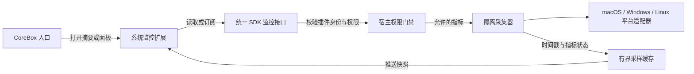

# Pulse 竞品分析与独立系统监控扩展建议

> 日期：2026-10-11
> 状态：调研完成；后续作为独立外置扩展，具体功能与接口为建议，未实施。
> 方法：官网真实浏览器交互、官方截图、公开反馈、MyGo 许可证与当前仓库 SDK 源码。
> 验证边界：未安装或运行 Pulse，未实测采集准确度、性能或跨平台一致性。
> 范围：不并入现有插件迁移，不调整版本与全局优先级；保留内置与特权机制。

建议新增独立外置扩展“系统监控”，暂名 `touch-system-monitor`。
定位是快速定位资源占用，支持从 CoreBox 打开和分离窗口。
不要并入系统动作插件，也不要直接嵌入 Pulse 的原生窗口。

## 1. 借鉴诊断路径，不照搬整个应用

Pulse 把 CPU、内存、GPU、磁盘、网络和电池放在同一总览。
用户从异常指标进入详情，再找到具体应用和进程。
进程页提供搜索、排序、应用分组和右侧详情。
官网还展示父子进程、历史、退出和强制退出能力。

最值得借鉴的是三个设计：
- **应用归因**：让用户知道哪个应用占资源，而不只看到 PID。
- **分层查看**：先看总览，再看排名，最后查看单个进程。
- **连续观察**：显示趋势和时间范围，区分瞬时峰值与持续占用。

点阵图有辨识度，但读数精度需要验证。
Tuff 可以借鉴低噪声排版，趋势图优先用易读的折线。
CPU 和内存保留语义色，危险操作使用独立警示色。

已在真实浏览器检查下载菜单和截图放大交互。
官网进程页展示可搜索排序的表格、应用图标和右侧进程详情。
这些是宣传截图，不是本机采样结果；原图见下方来源链接。

来源：[Pulse 官网](https://pulse.egoist.dev/)、[原始进程截图](https://pulse.egoist.dev/shots/processes-light.jpg)。

## 2. 产品可参考，源码不能默认复用

| 事项 | 已核对的事实 | 对扩展的影响 |
|---|---|---|
| 定位 | 免费的桌面活动监视器 | 和 Tuff 工具扩展场景匹配 |
| macOS | 下载菜单提供 Apple silicon DMG | 官网未提供 Intel Mac 下载项 |
| Windows | 提供 x64 和 Arm64 安装器 | 架构支持不代表指标完全相同 |
| Linux | 提供 x64 和 Arm64 DEB | 官网称使用 /proc、sysfs 和 hwmon |
| UI 技术 | 官网称使用 Go 与 MyGo 原生 GPU UI，无 WebView | 不能当成网页直接塞进插件视图 |
| 性能 | 官网称窗口显示时约占一个核心的 3% | 是官方口径，本轮未实测，不能套用到 Tuff |
| 源码与授权 | 官网链接的是 MyGo 源码和 Pulse 反馈仓库 | 未发现官网提供 Pulse 源码、复用许可或集成 API |

MyGo 使用 MIT 许可证，但这不等于 Pulse 也采用 MIT。
“免费使用”也不等于允许复制源码、素材或再分发。

建议借鉴产品结构，自行实现扩展。
若以后只想启动已安装的 Pulse，应作为单独的外部应用集成。
这与 Tuff 自有系统监控是两条路线。

公开反馈中有 Windows 多磁盘漏识别报告。
该报告针对 0.1.11，当前页面仍为 Open。
它是用户反馈，不是本轮复现，也不足以评判整体质量。

来源：[MyGo 官网](https://mygo.egoist.dev/)、[MyGo MIT 许可证](https://github.com/egoist/mygo/blob/main/LICENSE)、[Pulse 反馈仓库](https://github.com/egoist/pulse-feedback)、[多磁盘问题 #2](https://github.com/egoist/pulse-feedback/issues/2)。

## 3. 独立扩展的边界要按职责划分

| 模块 | 建议职责 | 不应承担的职责 |
|---|---|---|
| `touch-system-monitor`（拟新增） | 实时总览、资源排名、进程详情和趋势 | 关机、调亮度、窗口布局 |
| `touch-system-actions`（已有） | 系统控制和快捷动作 | 常驻资源采样 |
| `touch-window-manager`（已有） | 应用窗口调度和布局 | CPU、内存和网络统计 |
| `touch-quickops`（已有） | 一次性查询和快捷工具 | 再做一套连续监控页面 |
| 宿主开放能力 | 采集、权限校验、订阅和平台支持声明 | 监控页面、业务排序和展示逻辑 |

产品入口建议：
- 搜索“系统监控”，打开完整面板。
- 搜索“CPU 占用”“内存压力”，显示摘要并进入对应页。
- 分离成独立窗口，持续观察资源变化。
- 菜单栏监控作为用户主动开启的模式。

完整面板使用“总览 + 进程表格 + 详情侧栏”。
刷新时保留选中项、排序和滚动位置。
不要每次刷新都让用户正在查看的行换位置。

应用分组要覆盖浏览器、Electron 和开发工具的子进程。
Node、Python、Claude 等不能只按进程名合并。
结合可验证的应用身份和父子关系，允许切回原始进程。
共享内存的统计口径要说明，不能把分组相加当作唯一真值。

## 4. SDK 261011 已存在，监控契约仍有缺口

当前源码已包含 `SdkApi.V261011`。
`CURRENT_SDK_VERSION` 也已设为 `261011`。
这说明版本标记已经写入，不能据此宣称所有能力已验收。

| 当前能力 | 已有字段或行为 | 对连续监控还缺什么 |
|---|---|---|
| `quickOps.systemInfo()` | CPU 型号、核心数、内存总量、空闲内存、运行时长和负载 | CPU 时间差、内存压力和持续订阅 |
| `quickOps.diskSpace()` | 卷容量、剩余容量和使用比例 | 读写速率和进程归因 |
| `quickOps.networkStatus()` | 地址、DNS 和代理配置 | 接口吞吐和应用流量 |
| `quickOps.batteryStatus()` | 电量、充电状态和来源 | 健康度、循环次数、功耗和温度 |
| System SDK | 当前应用、应用解析和系统入口 | 全部进程的实时指标 |
| 权限注册表 | `system.shell`、`system.applications`、`system.tray` | 只读监控与进程控制的细分权限 |

现有“网络状态”是网络配置，不是网络速度。
空闲内存字段也不能替代 macOS 内存压力。
此次检查的公开 SDK 中未见完整监控订阅契约。
这不代表仓库所有内部采集代码都不存在。

建议复用已有采集基础，补统一的监控接口。
不要让插件每秒启动 shell 命令，也不要暴露任意命令执行。

源码依据：
- [packages/utils/plugin/sdk-version.ts](../../../packages/utils/plugin/sdk-version.ts)，行 69–100
- [packages/utils/plugin/sdk/quick-ops.ts](../../../packages/utils/plugin/sdk/quick-ops.ts)，行 39–105
- [packages/utils/transport/events/types/quick-ops.ts](../../../packages/utils/transport/events/types/quick-ops.ts)，行 95–110,149–176,501–534
- [packages/utils/plugin/sdk/system.ts](../../../packages/utils/plugin/sdk/system.ts)，行 93–120
- [packages/utils/permission/registry.ts](../../../packages/utils/permission/registry.ts)，行 100–132

## 5. 开放采集接口，保留原有特权机制

下面是设计建议，接口名和权限名尚未实现。
保留已有内置与特权机制，不把新扩展绑死在名字白名单。
新扩展通过统一授权接口访问指标，并独立安装、升级和卸载。

建议接口覆盖：能力查询、一次性快照、订阅和取消订阅。
进程列表与详情共用采样结果，避免每个窗口重复采集。
采集器不应阻塞 Electron 主进程。
是否使用现有 Worker 或原生组件，需在实施时核对。

权限至少区分：系统总量、进程明细和进程控制。
这些是权限类别建议，不是当前注册表中的权限 ID。
只读监控不应要求用户授予高风险 shell 权限。
菜单栏功能另行申请现有 `system.tray` 权限。

进程控制必须校验 PID 与启动身份，防止 PID 复用误杀。
优先提供正常退出，强制退出单独确认。
保护宿主、采集器和关键系统进程。
不要提供“结束所有同名进程”或自动清内存功能。

## 6. 基础指标先做实，深层指标按平台声明

这是建议实施顺序，不是本轮已经完成的功能。
最终范围由后续需求确认，不能用基础指标冒充完整 Pulse 替代。

| 功能组 | 建议顺序 | 主要风险 |
|---|---|---|
| CPU 总量、每核时间、内存、卷容量和接口速率 | 优先 | 采样差分、计量口径和多卷识别 |
| 进程 CPU、内存、父子关系与应用分组 | 与基础面板一起验证 | 短命进程、访问限制、归属和共享内存 |
| 内存压力、压缩内存、交换活动和电池信息 | 按平台补齐 | 平台语义不同，无电池设备需要明确状态 |
| GPU 使用率、显存和引擎 | 能力探测后开放 | GPU 厂商、驱动和硬件差异 |
| 每应用网络、磁盘读写和能耗 | 单独验证采集路线 | 权限、归因和采样开销 |
| 温度、风扇、整机功率和阻止休眠原因 | 最后评估 | 传感器、机型和系统版本差异 |

macOS、Windows、Linux 不能承诺所有字段一致。
Pulse 官网自己也分别描述了各平台的数据能力。
扩展应逐指标返回支持状态、数据来源和时间戳。
权限拒绝、硬件不支持、采集错误和数据过期必须分开。
缺失指标显示原因，不能用 0 伪装正常读数。

CPU 要说明单核 100% 还是整机归一化 100%。
网络和磁盘速率要用计数差与实际时间差计算。
接口重建、休眠唤醒和计数重置后，重建采样基线。
内存压力不要直接照抄截图里的百分比，先验证数据定义。

## 7. 监控扩展自身不能成为负载来源

建议默认只在可见面板存在时持续采样。
关闭 CoreBox 不代表停止采样，分离窗口可能仍可见。
所有面板都隐藏后停止订阅，菜单栏模式另算。
禁用或卸载扩展时，释放订阅、定时器和辅助进程。

采样策略建议：
- 可见面板先以约 1 秒间隔采样，再根据实测调整。
- 图标和进程身份缓存，避免每次采样都重新解析。
- 历史记录使用有界内存缓存，默认不落盘。
- 暂停查看时明确区分“暂停显示”和“暂停采集”。

这些是设计目标，不是本轮测得的性能结果。
不能照抄 Pulse 的 CPU 宣传数字作为 Tuff 性能承诺。

进程命令行可能包含密钥、文件路径和私人项目名。
默认不采集完整命令行，不上传进程列表或历史。
若以后增加 AI 诊断，必须另行授权并展示发送内容。

## 8. 后续先验收采集，再验收整套扩展

最先证明“能可信地定位占资源的应用”。
不要先画好仪表盘，再用不准确的数据补上。

| 验收场景 | 必须观察的结果 |
|---|---|
| 启动受控 CPU 和内存负载 | 对应应用与进程排名变化，和系统工具按同一口径对照 |
| 浏览器或 Electron 多进程 | 分组包含正确子进程，原始进程仍可查看 |
| 持续磁盘和网络活动 | 速率随活动变化，停止后回落，不重复累计 |
| 多卷、多网卡与无电池设备 | 正确枚举，缺失能力显示原因 |
| 拒绝和撤销权限 | 停止对应采集，旧数据标记过期 |
| 分离窗口、隐藏窗口和卸载 | 采样随实际可见订阅存在，不遗留后台任务 |
| 进程退出或 PID 复用 | 旧详情不串到新进程，旧控制目标失效 |
| 连续运行与反复开关 | 记录采集器和 UI 自身开销，内存与订阅数量不持续增长 |

下一步若进入实现，先确认三端指标支持矩阵。
再定义开放 SDK 契约，并跑真实负载采集验证。
最后实现 CoreBox 摘要、完整面板和分离窗口。

本报告记录产品与接口分析，扩展与 SDK 监控能力尚未实施。
已检查官网真实交互、原始截图、公开反馈和当前 SDK 源码。
未安装或运行 Pulse，未验证其采集准确度和实际资源占用。
